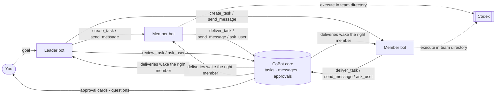

# CoBot

**Agents do the work. CoBot runs the team.**

English · [简体中文](README.zh-CN.md)

> **Status: early preview.** The Windows local Web version is ready to try. The desktop shell
> and macOS compile, but native runtime and installation are not yet verified. See [Status](#status).

CoBot is a local-first app where AI agents work together as a team. The *Co* stands for
**cooperation**: CoBot doesn't try to be a smarter agent. It is the team structure around your
agents. It handles roles, tasks, messages and approvals, and external agents
(currently [Codex](https://github.com/openai/codex)) do the actual work: reading code,
running commands, editing files.

Coding is the first use case, and CoBot is built with CoBot: its own agent team has already
planned, implemented, reviewed and delivered real changes to this repository.

<!-- TODO: screenshot or short GIF — team list, a member conversation, an approval card -->

## Why CoBot

A single coding agent works well. Several of them on the same project quickly turn into a mess:

- Nobody knows who is doing what, and two agents edit the same thing.
- "Done" means "the model said it's done".
- Agents wake each other up in endless loops and burn your budget.
- When something crashes, you can't tell what actually ran.

CoBot handles this the way a well-run team does: a lead who breaks down work, members with
clear roles, a task board, written deliveries that get reviewed, and a human who signs off on
what matters.

## How it works



1. **Create a team** on a working directory. A leader and members with built-in roles
   (product manager, backend, frontend, QA, code reviewer) get their own agent sessions.
   You can add or remove members later from the team's settings.
2. **Give the leader a goal.** It agrees the plan with you, then breaks it into tasks with
   owners, dependencies and acceptance criteria.
3. **Members collaborate through structured tools** (MCP), not by parsing chat. Every
   action they take becomes a fact in CoBot's database, and that fact wakes up whoever needs
   to act next.
4. **You stay in charge.** Native command and file approvals, questions from agents, and
   collaboration chains that hit their limit all come to you.

## Features

- **Role-based collaboration.** Each bot sees only the tools its role needs. The leader has
  `send_message`, `ask_user`, `create_task`, `review_task` and `view_tasks`; members have
  `send_message`, `ask_user`, `deliver_task` and `view_tasks`. The host binds each call to
  the member's identity, so a model can't act as someone else.
- **Delivery and review.** A member delivers a task with what it did, how to check it and
  what it verified. The leader (or you) accepts it, which completes the task and releases the
  tasks waiting on it, or sends it back with a reason. CoBot moves the task status itself; the
  model never drives the state machine.
- **Human in the loop.** Native Codex approvals show the full command or diff, with Codex's
  own choices: allow, allow for this session, decline, or decline and stop (requests for extra
  access: allow for this turn or this session, or deny). Each team has a permission mode
  (read only, default, full access). Agents can ask you questions and are woken when you
  answer. A message you send while a member is working goes into its running turn, or is
  queued if the turn has already ended.
- **Runaway control.** Each collaboration chain may wake members a limited number of times
  (10 by default). Past the limit the chain waits for you: Continue grants a fresh budget of
  the same size, Stop ends it. An optional token budget, per member or per team, pauses new
  turns.
- **Visible work.** Each turn's steps, tool calls and file changes show in the conversation.
  Session stats under the composer show turns, model and tool time, tokens and cache, context
  in use and account limits. Each team chooses the reasoning effort from the levels the model
  offers. Codex sub-agents a member starts work inside that member's run, with their steps,
  approvals and usage attributed to it.
- **Memory (read-only for now).** Memories that members saved in earlier builds can be viewed
  and deleted, and are handed to new threads; models can no longer save new ones. Memory will
  be reworked later.
- **Honest recovery.** After a restart, CoBot reconciles what really happened. If an
  execution's outcome is unknown, CoBot locks it and shows a recovery card. It never
  guesses and silently reruns.
- **Local-first.** CoBot is a single executable that binds to loopback only. Your data stays
  in `~/.cobot`. Agents run in a private Codex environment with its own login, separate from
  your everyday Codex setup. No cloud service. A browser sign-in lasts 30 days, is renewed while
  in use and survives restarts.
- **Web UI and desktop shell.** Both run on one shared core. The UI is available in English
  and Chinese.

CoBot doesn't run shell commands, manage Git or reimplement an agent loop. That stays with
the agent you already trust.

## Status

| Platform | Status |
| --- | --- |
| Windows 10/11 x64, local Web | **Ready to try.** Verified with real Codex end to end |
| Windows standalone server build | Builds and runs |
| Windows desktop shell (Wails/WebView2) | Compiles; not yet verified at runtime |
| macOS (Web / desktop) | Cross-compiles; `.app` packaging reviewed statically only; native runtime, installation, signing and notarization not yet verified |

With real Codex on Windows we verified: sign-in, multi-member parallel work, task handoffs and
questions, native file approvals and rejections, collaboration limits, reconnecting after a
dropped connection, graceful shutdown, crash recovery and upgrades.
The headline test was two consecutive rounds of **CoBot developing CoBot**. In each round
the leader planned the work, a member implemented it, a separate member reviewed it, and a
human approved the exact candidate commit. The second round ran on the upgraded build that
included the first round's change.

Since then the collaboration model was simplified: role-based tools, one-step delivery and
review, no model risk checks, and no recruitment or merge approval cards. A multi-member run
with real Codex verified the new flow, including native approvals, session stats and Codex
sub-agents.

Tested does not mean every edge case is covered. The maintainers track the 94 first-release
acceptance items and record which parts were verified automatically, with a real model, or
not yet.

## Quick start

**You need:** Go 1.25.12+, Node.js 24+ (npm 11+), and the [Codex CLI](https://github.com/openai/codex)
installed (verified with 0.161.0).

```bash
git clone https://github.com/kunghim/CoBot.git
cd CoBot
npm ci --prefix frontend
./scripts/build.sh --target server        # Windows: powershell -File scripts/build.ps1 -Target server

.tmp/dist/cobot serve                     # development profile, data in ~/.cobot-dev
```

Your default browser opens CoBot, already signed in. Behind the scenes it uses a one-time
startup link (valid 60 seconds, also printed in the terminal; `--no-open` only prints it).
Running `cobot serve` again opens a fresh link to the running instance.
Then:

1. **Settings:** sign in to Codex. CoBot uses its own private Codex environment, so you sign
   in once inside CoBot; the login is kept across restarts. Then pick a default model.
   CoBot finds Codex and authorizes its safety hook by itself at startup; Settings shows
   both, with a button to authorize again if that failed.
2. **New team:** choose a working directory and the members you want.
3. **Message the leader** with what you want built.

Use `cobot serve --profile production` for everyday use (data in `~/.cobot`).
Treat startup links like passwords.

## Development

```bash
./scripts/dev.sh      # Go core + Vite with auto-authorization   (Windows: scripts/dev.ps1)
./scripts/check.sh    # gofmt, contract drift, frontend + Go tests (Windows: scripts/check.ps1)
```

`cobot trace on|off|status|view` records every raw exchange under `<data root>/traces/` for
debugging. Recordings are unredacted and can contain prompts, code and credentials: never
commit or share them.

Stack: Go · React + TypeScript + Vite · TanStack Query · Tailwind CSS · SQLite (modernc) +
goose · Wails v2 · HTTP JSON + SSE · MCP Go SDK. The API contract lives in `api/openapi.yaml`,
and Go and TypeScript types are generated from it.

Start with [CONTRIBUTING.md](CONTRIBUTING.md). Issues and pull requests in
English or Chinese are welcome. For security reports, see [SECURITY.md](SECURITY.md).

## Roadmap

These are directions we intend to explore, not commitments:

- Verified desktop builds for Windows and macOS
- More agent engines beyond Codex
- Teams for non-coding work: office tasks, learning, writing and creative projects

## License

Copyright 2026 CoBot contributors. Licensed under the [Apache License 2.0](LICENSE).
Third-party dependencies retain their respective licenses.
