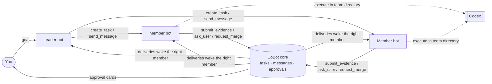

# CoBot

**Agents do the work. CoBot runs the team.**

English · [简体中文](README.zh-CN.md)

> **Status: early preview.** The Windows local Web version is ready to try. Desktop and macOS
> builds exist but are not yet verified. See [Status](#status).

CoBot is a local-first app where AI agents work together as a team. The *Co* stands for
**cooperation**: CoBot doesn't try to be a smarter agent. It is the team structure around your
agents. It handles roles, tasks, messages, approvals and shared memory, and external agents
(currently [Codex](https://github.com/openai/codex)) do the actual work: reading code,
running commands, editing files.

Coding is the first use case, and CoBot is built with CoBot: its own agent team has already
planned, implemented, reviewed and delivered real changes to this repository.

<!-- TODO: screenshot or short GIF — team list, a member conversation, an approval card -->

## Why CoBot

A single coding agent works well. Several of them on the same project quickly turn into a mess:

- Nobody knows who is doing what, and two agents edit the same thing.
- "Done" means "the model said it's done".
- Agents wake each other up in endless loops and burn your budget.
- When something crashes, you can't tell what actually ran.

CoBot handles this the way a well-run team does: a lead who breaks down work, members with
clear roles, a task board, written evidence, and a human who signs off on what matters.

## How it works



1. **Create a team** on a working directory. A leader and members with built-in roles
   (product manager, backend, frontend, QA, code reviewer) get their own agent sessions.
2. **Give the leader a goal.** It breaks the goal into tasks with owners, dependencies and
   acceptance criteria.
3. **Members collaborate through structured tools** (MCP), not by parsing chat. Every
   action they take becomes a fact in CoBot's database, and that fact wakes up whoever needs
   to act next.
4. **You stay in charge.** Native command and file approvals, merge authorization and
   risky collaboration loops all come to you as cards.

## Features

- **Structured collaboration.** 19 MCP tools for tasks, messages, evidence, transfers,
  questions and merge requests. The host binds each call to the member's identity, so a
  model can't act as someone else.
- **Evidence before "done".** Only the leader or you can confirm a task, and only with
  evidence. A merge request is bound to an exact candidate commit, target and matching
  test/review evidence. If any of those change, the old approval no longer counts.
- **Human in the loop.** Native approvals show the full command or diff. Agents can ask you
  questions, and related work waits for your answer.
- **Runaway control.** Collaboration chains have round limits, risky continuations need
  your confirmation, and an optional usage budget pauses new work.
- **Memory.** Each member has its own memory that persists across sessions.
- **Honest recovery.** After a restart, CoBot reconciles what really happened. If an
  execution's outcome is unknown, CoBot locks it and shows a recovery card. It never
  guesses and silently reruns.
- **Local-first.** CoBot is a single executable that binds to loopback only. Your data stays
  in `~/.cobot`. Agents run in a private Codex environment with its own login, separate from
  your everyday Codex setup. No cloud service.
- **Web UI and desktop shell.** Both run on one shared core. The UI is available in English
  and Chinese.

CoBot doesn't run shell commands, manage Git or reimplement an agent loop. That stays with
the agent you already trust.

## Status

| Platform | Status |
| --- | --- |
| Windows 10/11 x64, local Web | **Ready to try.** Verified with real Codex end to end |
| Windows standalone server build | Builds and runs |
| Windows desktop shell (Wails/WebView2) | Compiles; not yet verified at runtime |
| macOS (Web / desktop) | Builds; native runtime, signing and notarization not yet verified |

With real Codex on Windows we verified: sign-in, multi-member parallel work, task handoffs and
questions, native file approvals and rejections, merge approval feedback, risk checks,
reconnecting after a dropped connection, graceful shutdown, crash recovery and upgrades.
The headline test was two consecutive rounds of **CoBot developing CoBot**. In each round
the leader planned the work, a member implemented it, a separate member reviewed it, and a
human approved the exact candidate commit. The second round ran on the upgraded build that
included the first round's change.

Tested does not mean every edge case is covered. The maintainers track all 94 acceptance
items and record which parts were verified automatically, with a real model, or not yet.

## Quick start

**You need:** Go 1.25+, Node.js 24+ (npm 11+), and the [Codex CLI](https://github.com/openai/codex)
installed (verified with 0.161.0).

```bash
git clone https://github.com/kunghim/CoBot.git
cd CoBot
npm ci --prefix frontend
./scripts/build.sh --target server        # Windows: powershell -File scripts/build.ps1 -Target server

.tmp/dist/cobot serve                     # development profile, data in ~/.cobot-dev
```

Your default browser opens CoBot, already signed in. Behind the scenes it uses a one-time
startup link (valid 60 seconds, also printed in the terminal; `--no-open` only prints it).
Running `cobot serve` again opens a fresh link to the running instance.
Then:

1. **Settings:** sign in to Codex. CoBot uses its own private Codex environment, so you sign
   in once inside CoBot. Then pick a default model.
   Settings also shows whether CoBot's native safety hook is trusted. Codex requires you to
   review it once with `/hooks`; see [CONTRIBUTING.md](CONTRIBUTING.md).
2. **New team:** choose a working directory and the members you want.
3. **Message the leader** with what you want built.

Use `cobot serve --profile production` for everyday use (data in `~/.cobot`).
Treat startup links like passwords.

## Development

```bash
./scripts/dev.sh      # Go core + Vite with auto-authorization   (Windows: scripts/dev.ps1)
./scripts/check.sh    # lint, contract drift, frontend + Go tests (Windows: scripts/check.ps1)
```

Stack: Go · React + TypeScript + Vite · TanStack Query · Tailwind CSS · SQLite (modernc) +
goose · Wails v2 · HTTP JSON + SSE · MCP Go SDK. The API contract lives in `api/openapi.yaml`,
and Go and TypeScript types are generated from it.

Start with [CONTRIBUTING.md](CONTRIBUTING.md) and [AGENTS.md](AGENTS.md).

## Roadmap

These are directions we intend to explore, not commitments:

- Verified desktop builds for Windows and macOS
- More agent engines beyond Codex
- Teams for non-coding work: office tasks, learning, writing and creative projects

## License

Not decided yet. Until a license is published, this repository does not grant one.
