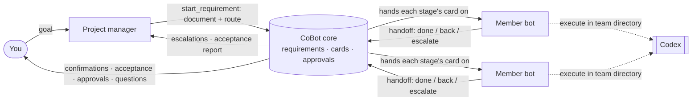

# CoBot

**Agents do the work. CoBot runs the team.**

English · [简体中文](README.zh-CN.md)

> **Status: early preview.** The Windows local Web version is ready to try. The desktop shell
> and macOS compile, but native runtime and installation are not yet verified. See [Status](#status).

CoBot is a local-first app where AI agents work together as a team. The *Co* stands for
**cooperation**: CoBot doesn't try to be a smarter agent. It is the team structure around your
agents. It handles roles, tasks, messages and approvals, and external agents
(currently [Codex](https://github.com/openai/codex)) do the actual work: reading code,
running commands, editing files.

Coding is the first use case, and CoBot is built with CoBot: its own agent team has already
planned, implemented, reviewed and delivered real changes to this repository.

<!-- TODO: screenshot or short GIF — team list, a member conversation, an approval card -->

## Why CoBot

A single coding agent works well. Several of them on the same project quickly turn into a mess:

- Nobody knows who is doing what, and two agents edit the same thing.
- "Done" means "the model said it's done".
- Agents wake each other up in endless loops and burn your budget.
- When something crashes, you can't tell what actually ran.

CoBot handles this the way a well-run team does: a project manager who writes the requirement
and plans the route, members who pass the work along that route, handoffs that are written down
with what actually ran, reviews and tests that can send work back, and a human who signs off on
what matters.

## How it works



1. **Create a team** on a working directory. A project manager and members with built-in roles
   (product manager, full-stack engineer, QA engineer, reviewer) get their own agent sessions.
   You can add or remove members later from the team's settings.
2. **Give the project manager a goal.** Once the need is clear it writes a requirement document and
   picks this requirement's route from the full process (requirements review, product design, test
   cases, implementation, testing, code review…), and you confirm both.
3. **Members pass the work along the route.** Each stage is a card handed to its owner; the owner
   hands it off with `handoff`, and CoBot moves it to the next stage, so no model decides who is next.
   Reviews and tests can send work back to the stage that produced it; past the limit, or when
   stuck, the card goes to the project manager.
4. **You stay in charge.** Confirmations, the final acceptance, native command and file approvals and
   questions from agents all come to you, and you can cancel a requirement at any time.

## Features

- **Role-based collaboration.** The project manager has `start_requirement`, `handoff`,
  `view_tasks`, `send_message` and `ask_user`; members have `handoff`, `view_tasks`,
  `send_message` and `ask_user` (only for what only you can decide). `send_message` leaves a note
  and wakes nobody: work moves only on cards. The host binds each call to the member's identity, so
  a model can't act as someone else, and a sub-agent can't hand off a card, start a requirement or
  ask you.
- **Relay and acceptance.** Each card opens with the requirement, the route and where it stands,
  then the requirement document and earlier handoffs; a review card also carries its checklist. On
  handoff CoBot attaches the commands, exit codes and changed files the engine reported. Reviews and
  tests can send work back (rerun the route, or straight back to the reviewer); past the limit (3
  by default, adjustable in settings) the project manager decides. Optional improvements pass with
  suggestions, collected for the final report. The route ends with the project manager's acceptance
  report, which becomes your acceptance card. CoBot moves the cards itself; the model never drives
  the state machine.
- **Human in the loop.** Native Codex approvals show the full command or diff, with Codex's
  own choices: allow, allow for this session, decline, or decline and stop (requests for extra
  access: allow for this turn or this session, or deny). Each team has a permission mode
  (read only, default, full access). Agents can ask you questions and are woken when you
  answer. A message you send while a member is working goes into its running turn, or is
  queued if the turn has already ended.
- **Runaway control.** Each collaboration chain may wake members a limited number of times
  (10 by default). Past the limit the chain waits for you: Continue grants a fresh budget of
  the same size, Stop ends it. An optional token budget, per member or per team, pauses new
  turns.
- **Visible work.** Each turn's steps, tool calls and file changes show in the conversation.
  Session stats under the composer show turns, model and tool time, tokens and cache, context
  in use and account limits. Each team chooses the reasoning effort from the levels the model
  offers. Codex sub-agents a member starts work inside that member's run, with their steps,
  approvals and usage attributed to it.
- **Memory (read-only for now).** Memories that members saved in earlier builds can be viewed
  and deleted, and are handed to new threads; models can no longer save new ones. Memory will
  be reworked later.
- **Honest recovery.** After a restart, CoBot reconciles what really happened. If an
  execution's outcome is unknown, CoBot locks it and shows a recovery card. It never
  guesses and silently reruns.
- **Local-first.** CoBot is a single executable that binds to loopback only. Your data stays
  in `~/.cobot`. Agents run in a private Codex environment with its own login, separate from
  your everyday Codex setup. No cloud service. A browser sign-in lasts 30 days, is renewed while
  in use and survives restarts.
- **Web UI and desktop shell.** Both run on one shared core. The UI is available in English
  and Chinese.

CoBot doesn't run shell commands, manage Git or reimplement an agent loop. That stays with
the agent you already trust.

## Status

| Platform | Status |
| --- | --- |
| Windows 10/11 x64, local Web | **Ready to try.** Verified with real Codex end to end |
| Windows standalone server build | Builds and runs |
| Windows desktop shell (Wails/WebView2) | **Beta downloads available.** Desktop startup and installer lifecycle checked in Windows Sandbox; see the release notes for limitations |
| macOS (Web / desktop) | Cross-compiles; `.app` packaging reviewed statically only; native runtime, installation, signing and notarization not yet verified |
| Linux (local Web) | Shared-core build, integration and browser tests run in Ubuntu CI with a fake engine; real Codex use and end-user installation are not yet verified |

With real Codex on Windows we verified: sign-in, multi-member parallel work, task handoffs and
questions, native file approvals and rejections, collaboration limits, reconnecting after a
dropped connection, graceful shutdown, crash recovery and upgrades.
The headline test was two consecutive rounds of **CoBot developing CoBot**. In each round
the project manager planned the work, a member implemented it, a separate member reviewed it, and a
human approved the exact candidate commit. The second round ran on the upgraded build that
included the first round's change.

Since then the collaboration model was simplified: role-based tools, one-step delivery and
review, no model risk checks, and no recruitment or merge approval cards. A multi-member run
with real Codex verified the new flow, including native approvals, session stats and Codex
sub-agents.

Tested does not mean every edge case is covered. The maintainers track the 94 first-release
acceptance items and record which parts were verified automatically, with a real model, or
not yet.

## Quick start

### Windows desktop downloads

[**v0.1.0-beta.1 — downloads and release notes**](https://github.com/kunghim/CoBot/releases/tag/v0.1.0-beta.1)

| Download | How to use |
| --- | --- |
| [Windows x64 MSI](https://github.com/kunghim/CoBot/releases/download/v0.1.0-beta.1/CoBot-0.1.0-beta.1-windows-x64.msi) | Install for your current user, then open **CoBot** from the Start menu |
| [Windows x64 ZIP](https://github.com/kunghim/CoBot/releases/download/v0.1.0-beta.1/CoBot-0.1.0-beta.1-windows-x64.zip) | Extract all files into one folder and open **cobot-desktop.exe**; keep both helper executables beside it |

Both downloads contain the same application files. You need **Windows 10/11 x64**, an existing
**WebView2 Runtime**, and the official **Codex CLI 0.161.0 or newer on `PATH`**, with an eligible
account and network access to Codex services. Codex is not bundled. This beta supports official
Codex account sign-in; third-party relay configurations are outside its supported scope.
You do not need Go or Node to use these downloads.

The packages are unsigned. Optional `.sha256` checksum files are on the release page.
GitHub's **Source code** archives are for building, not ready-to-run applications.
After opening CoBot, sign in under **Settings → Codex engine**, choose a model and create a team.
CoBot uses a private Codex environment with its own login.

Updates are manual: close CoBot before installing a newer MSI, or extract a complete newer ZIP
into a new folder. Both editions store settings and team data in `%USERPROFILE%\.cobot`, separate
from program files. Uninstalling the MSI or deleting an extracted ZIP folder retains that data.

### Build from source

The commands below build the **local Web** version. macOS instructions are for unverified
source trials; no macOS application download is included in this release.

**Build prerequisites:** Git, [Go](https://go.dev/dl/) compatible with `go.mod`
(minimum 1.25.12), and [Node.js 24](https://nodejs.org/en/download) with npm 11+.
For agent work, install the [Codex CLI](https://github.com/openai/codex) on `PATH`
(minimum and verified version: 0.161.0), with an account that can use Codex and
network access to its service. Go and Node are build tools; the resulting CoBot
executable still needs Codex for agent work. Local-first does not mean offline
model execution.

#### Windows (PowerShell)

```powershell
git clone https://github.com/kunghim/CoBot.git
cd CoBot
npm ci --prefix frontend
powershell -NoProfile -File scripts/build.ps1 -Target server
.\.tmp\dist\cobot.exe serve
```

#### macOS (Bash; native runtime unverified)

```bash
git clone https://github.com/kunghim/CoBot.git
cd CoBot
npm ci --prefix frontend
./scripts/build.sh --target server
./.tmp/dist/cobot serve
```

Run these commands in a terminal on the same computer as your browser and team
files. This starts the local Web app, not the desktop shell or a remote server.
The build writes `.tmp/dist/cobot.exe` on Windows or `.tmp/dist/cobot` on macOS,
with a `.sha256` checksum. It does not install CoBot on `PATH`; use the full
relative path shown above. Keep the terminal open while using CoBot.

Your default browser opens CoBot, already signed in. Behind the scenes it uses a one-time
startup link (valid 60 seconds, also printed in the terminal; `--no-open` only prints it).
This authorizes the local CoBot page; it does not sign you in to Codex. Treat
startup links like passwords. If the browser does not open, use the printed link.
If the link expires, rerun the same executable with `serve` in another terminal:
it opens a fresh link to the existing instance, without starting a second one.

The interface initially opens in Chinese. To switch to English, open
**设置 (Settings) → 通用 (General) → 语言 (Language)** and select **English**.
This preference is saved for subsequent visits; agent replies are not translated.

1. **Settings:** sign in to Codex. CoBot uses its own private Codex environment, so you sign
   in once inside CoBot; the login is kept across restarts. Then pick a default model.
   CoBot finds Codex and authorizes its safety hook by itself at startup; Settings shows
   both, with a button to authorize again if that failed.
2. **New team:** choose a working directory and the members you want.
3. **Message the project manager** with a small, checkable goal. For example: "Inspect this
   project and propose three improvements. Do not edit files yet." Agent replies
   follow the conversation and role instructions, not the interface language.

Closing the browser leaves the service running. To stop it, press **Ctrl+C in
the terminal that started it** and wait for shutdown to finish.

The commands above use the default **development** profile (`~/.cobot-dev`).
For everyday use, stop that instance and run
`.\.tmp\dist\cobot.exe serve --profile production` on Windows or
`./.tmp/dist/cobot serve --profile production` on macOS. The production profile
uses `~/.cobot` and has separate settings, Codex login and teams; your preview
setup does not transfer automatically. `~` means your home directory. For an
isolated trial, add `--data-root <absolute-path-to-an-empty-directory>`.

If Settings cannot find Codex, check `codex --version` in the terminal used to
launch CoBot. After installing or updating Codex, reopen that terminal, restart
CoBot with the same profile and data root, and retry the check in Settings.
Do not attach startup links or raw trace recordings to a help request;
[Q&A](https://github.com/kunghim/CoBot/discussions/categories/q-a) accepts English
and Chinese.

## Development

```bash
./scripts/dev.sh      # Go core + Vite with auto-authorization   (Windows: scripts/dev.ps1)
./scripts/check.sh    # gofmt, contract drift, frontend + Go tests (Windows: scripts/check.ps1)
```

`cobot trace on|off|status|view` records every raw exchange under `<data root>/traces/` for
debugging. Recordings are unredacted and can contain prompts, code and credentials: never
commit or share them.

Stack: Go · React + TypeScript + Vite · TanStack Query · Tailwind CSS · SQLite (modernc) +
goose · Wails v2 · HTTP JSON + SSE · MCP Go SDK. The API contract lives in `api/openapi.yaml`,
and Go and TypeScript types are generated from it.

Start with [CONTRIBUTING.md](CONTRIBUTING.md). Issues and pull requests in
English or Chinese are welcome. For security reports, see [SECURITY.md](SECURITY.md).

## Community

English and Chinese are welcome. One thread is enough; you do not need to
translate your report or join a separate chat group to participate.

- [Report a bug or request a feature](https://github.com/kunghim/CoBot/issues/new/choose).
- [Ask a setup or usage question](https://github.com/kunghim/CoBot/discussions/categories/q-a).
- [Share something you built](https://github.com/kunghim/CoBot/discussions/categories/show-and-tell).
- [Read maintainer announcements](https://github.com/kunghim/CoBot/discussions/categories/announcements).
- [Contribute](CONTRIBUTING.md): start from `dev` and open your PR against `dev`.

For vulnerabilities, use [SECURITY.md](SECURITY.md). Please follow the
[Code of conduct](CODE_OF_CONDUCT.md) and remove private data from shared examples.

## Roadmap

These are directions we intend to explore, not commitments:

- Verified desktop builds for Windows and macOS
- More agent engines beyond Codex
- Teams for non-coding work: office tasks, learning, writing and creative projects

## License

Copyright 2026 CoBot contributors. Licensed under the [Apache License 2.0](LICENSE).
Third-party dependencies retain their respective licenses.
