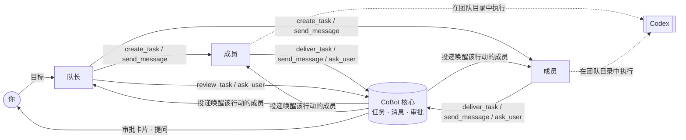

# CoBot

**Agent 干活，CoBot 带队。**

[English](README.md) · 简体中文

> **状态：早期预览。** Windows 本机 Web 版已经可以试用；桌面壳和 macOS 版可以编译，
> 原生运行与安装尚未实机验证。详见[当前状态](#当前状态)。

CoBot 是一个本地运行的应用，让多个 AI Agent 像团队一样协作。名字里的 **Co 是“合作”**：
CoBot 不想当一个更聪明的 Agent，而是 Agent 周围的团队组织。它管角色、任务、沟通和审批；
读代码、跑命令、改文件这些具体工作，交给外部 Agent（目前是 [Codex](https://github.com/openai/codex)）。

首个场景是编程，而且 CoBot 就是用 CoBot 开发的：它自己的 Agent 团队已经为本仓库规划、实现、
审查并交付了真实改动。

<!-- TODO：截图或短动图——团队列表、成员会话、审批卡片 -->

## 为什么需要 CoBot

一个编程 Agent 很好用。几个 Agent 同时做一个项目，很快就乱了：

- 谁在做什么说不清，两个 Agent 改同一处；
- “做完了”只是模型自己说做完了；
- Agent 之间互相唤醒、停不下来，额度烧光；
- 出了崩溃，搞不清到底执行了什么。

CoBot 用一个靠谱团队的方式解决这些问题：有队长拆任务，成员职责明确，有任务板，交付要写清楚并经过验收，
关键决定由人拍板。

## 工作方式



1. **建团队**：选一个工作目录，生成队长和内置角色成员（产品经理、后端、前端、测试、代码审查），
   每个成员有自己的 Agent 会话。之后可以在团队设置里增删成员。
2. **给队长一个目标**：队长先和你对齐方案，再拆成任务，写明负责人、依赖和验收标准。
3. **成员用结构化工具（MCP）协作**，不靠解析聊天。每个动作都成为 CoBot 数据库里的事实，
   再由事实唤醒下一个该行动的人。
4. **你始终掌控**：原生命令/文件审批、Agent 的提问、达到上限的协作链，都会交给你处理。

## 功能

- **按角色协作**：每个成员只看到自己角色需要的工具。队长有 `send_message`、`ask_user`、`create_task`、
  `review_task`、`view_tasks`；成员有 `send_message`、`ask_user`、`deliver_task`、`view_tasks`，
  评审员另有 `review_task`。每次调用的身份由宿主绑定，模型无法冒充其他成员。
- **交付与验收**：成员交付任务时写清做了什么、怎么查看成果、实际做了哪些验证。队长标注需要评审的任务
  （需求、设计、测试用例、代码等）交付后送评审员，附上对应的检查清单，由评审员的结论直接决定通过或打回；
  打回次数超过上限（默认 3 次，可在设置中调整）后改由队长决定。其他任务由队长（或你）验收。通过后任务完成，
  并放行依赖它的任务，打回时必须写明原因。一次方案的任务全部结束后，队长汇报交付结果，由你验收通过或要求修改。
  任务状态由 CoBot 自己推进，模型不用操作状态机。
- **人在回路中**：Codex 原生审批显示完整命令或 diff，选项与 Codex 一致：允许、本会话内允许、拒绝、
  拒绝并停止（申请额外权限时为：本轮允许、本会话内允许、拒绝）。每个团队可选权限模式（只读、默认、完全访问）。
  Agent 可以向你提问，你回答后它会被唤醒。成员工作时你发的消息会并入它正在进行的这一轮；
  这一轮已结束则排队等待。
- **防失控**：每条协作链唤醒成员的次数有上限（默认 10 次）。超过上限后协作链等你决定：继续会再给一份
  同样大小的额度，停止则结束这条链。可选的 token 预算（按成员或按团队）会暂停新的轮次。
- **工作过程可见**：每一轮的步骤、工具调用和文件改动都显示在会话里；输入框下的会话统计显示轮数、
  模型与工具用时、token 与缓存、上下文占用和账号额度。每个团队可从模型提供的档位中选择思考强度。
  成员启动的 Codex 子智能体在该成员的运行内工作，步骤、审批和用量都归属这名成员。
- **记忆（目前只读）**：早期版本里成员保存的记忆可以查看、删除，并会带进新会话；模型已不能再写入新记忆。
  记忆功能之后会重新设计。
- **诚实的恢复**：重启后核对真实发生了什么。执行结果不确定时，CoBot 会锁定并给出恢复卡，
  绝不猜测、偷偷重跑。
- **本地优先**：单个可执行文件，只监听本机回环地址，数据留在 `~/.cobot`。Agent 运行在私有 Codex 环境里，
  使用独立登录，和你日常的 Codex 互不影响。没有云服务，CoBot 不会把你的数据发到任何地方；它自己只会
  从本仓库下载公开的头像库（`assets/avatars`），时机是启动时和你在设置里点“检查更新”时。
  浏览器登录有效期 30 天，使用中自动续期，重启后仍然有效。
- **Web 界面与桌面壳**：两者共用一个核心。界面支持中文和英文。

CoBot 不执行 shell 命令、不管理 Git，也不重写 Agent 循环。这些仍由你信任的 Agent 去做。

## 当前状态

| 平台 | 状态 |
| --- | --- |
| Windows 10/11 x64 · 本机 Web | **可以试用**，已用真实 Codex 端到端验证 |
| Windows 独立服务构建 | 可构建、可运行 |
| Windows 桌面壳（Wails/WebView2） | 可编译；尚未实机验证 |
| macOS（Web / 桌面） | 可交叉编译；`.app` 打包仅做过静态核对；原生运行、安装、签名与公证尚未验证 |
| Linux（本机 Web） | Ubuntu CI 覆盖共享核心构建、集成和浏览器测试，使用假引擎；真实 Codex 使用和用户安装尚未验证 |

在 Windows 上用真实 Codex 验证过的内容：登录、多成员并行、任务交接与提问、原生文件审批与拒绝、
协作限轮、断线重连、正常退出、崩溃恢复和升级。
最关键的一项是连续两轮 **用 CoBot 开发 CoBot**：每一轮都由队长规划、一名成员实现、另一名成员独立审查，
再由人批准确切的候选提交；第二轮运行在已经包含第一轮改动的升级版本上。

此后协作方式做了精简：按角色提供工具、一步交付与验收、去掉模型风险评估，也去掉了招募和合并审批卡。
新流程已用真实 Codex 跑过一次多成员场景，覆盖原生审批、会话统计和 Codex 子智能体。

验证过不代表覆盖了所有边界情况。维护者对首版 94 个验收项逐项记录了哪些经过自动化验证、哪些用真实模型验证、哪些尚未验证。

## 快速开始

当前预览版从源码构建，建议先试用 **Windows 本机 Web 版**。
macOS 命令仅供源码试用，原生运行尚未验证，不代表已验证的发行版。

**构建前置条件**：Git、符合 `go.mod` 要求的 [Go](https://go.dev/dl/)（最低 1.25.12），
以及 [Node.js 24](https://nodejs.org/en/download) 和 npm 11+。
让 Agent 工作还需在 `PATH` 上安装 [Codex CLI](https://github.com/openai/codex)
（最低及已验证版本为 0.161.0），具备可使用 Codex 的账号和访问其服务的网络。
Go、Node 用于构建；构建后的 CoBot 程序仍需 Codex 执行 Agent 工作。本地优先不等于模型调用离线。

### Windows（PowerShell）

```powershell
git clone https://github.com/kunghim/CoBot.git
cd CoBot
npm ci --prefix frontend
powershell -NoProfile -File scripts/build.ps1 -Target server
.\.tmp\dist\cobot.exe serve
```

### macOS（Bash；原生运行未验证）

```bash
git clone https://github.com/kunghim/CoBot.git
cd CoBot
npm ci --prefix frontend
./scripts/build.sh --target server
./.tmp/dist/cobot serve
```

请在浏览器和团队文件所在的同一台电脑运行这些命令。这启动的是本机 Web 应用，
不是桌面壳或远程服务器。Windows 产物为 `.tmp/dist/cobot.exe`，macOS 为 `.tmp/dist/cobot`，
旁边附有 `.sha256` 校验和。脚本不会将 CoBot 加入 `PATH`，请使用上面的完整相对路径。
使用期间保持启动终端开启。

默认浏览器会自动打开并登录本机 CoBot 页面，这不等于已登录 Codex。一次性启动链接
仅在 60 秒内、单次有效，终端里也会打印；加 `--no-open` 则只打印不打开。
浏览器未打开时可使用终端链接；链接过期后，在另一个终端用相同路径再次运行 `serve`，
会为原实例打开新链接，不会启动第二个实例。启动链接要像密码一样对待。

界面初始为中文，可在 **设置 → 通用 → 语言** 切换 English，偏好会保存。然后：

1. **设置**：登录 Codex。CoBot 使用自己的私有 Codex 环境，需要在 CoBot 里登录一次，重启后仍然有效。
   然后选择默认模型。CoBot 启动时会自动找到 Codex 并授权它的安全钩子；设置页会展示这两项状态，
   授权失败时可以点按钮重新授权。
2. **新建团队**：选择工作目录和需要的成员。
3. **给队长发消息**，先给一个小而可检查的目标，例如：“查看这个项目并提出三项改进建议，
   暂时不要修改文件。”模型回复取决于对话和角色指令，不由界面语言自动翻译。

关闭浏览器不会停止服务。退出时，在启动服务的终端按 **Ctrl+C**，等待正常关闭完成。

上述命令默认使用 **development** profile（`~/.cobot-dev`）。日常使用时，先停止试用实例，
再在 Windows 运行 `.\.tmp\dist\cobot.exe serve --profile production`，
或在 macOS 运行 `./.tmp/dist/cobot serve --profile production`。
production 数据位于 `~/.cobot`，设置、Codex 登录和团队均独立，试用配置不会自动转移。
`~` 表示用户主目录；隔离试用可加 `--data-root <空目录的绝对路径>`。

设置页找不到 Codex 时，在启动 CoBot 的终端检查 `codex --version`。
安装或更新 Codex 后，重新打开终端，以相同 profile 和数据根重启 CoBot，再从设置页重试检查。
求助时不要附带启动链接或原始 trace；[Q&A](https://github.com/kunghim/CoBot/discussions/categories/q-a)
接受中文和英文。

## 参与开发

```bash
./scripts/dev.sh      # Go 核心 + Vite，自动授权               （Windows：scripts/dev.ps1）
./scripts/check.sh    # 格式、契约漂移、前端与 Go 测试         （Windows：scripts/check.ps1）
```

`cobot trace on|off|status|view` 会把所有原始交互录制到 `<数据根>/traces/`，用于排查问题。
录制内容未脱敏，可能包含提示词、代码和凭据，绝不要提交或分享。

技术栈：Go · React + TypeScript + Vite · TanStack Query · Tailwind CSS · SQLite（modernc）+ goose ·
Wails v2 · HTTP JSON + SSE · MCP Go SDK。接口契约在 `api/openapi.yaml`，Go 和 TypeScript 类型均由它生成。

请先阅读 [CONTRIBUTING.md](CONTRIBUTING.md)。欢迎使用中文或英文提交 Issue 和 PR；
安全问题请参阅 [SECURITY.md](SECURITY.md)。

## 社区参与

欢迎使用中文或英文，一份反馈即可，无需重复提交翻译，也无需加入额外聊天群。

- [报告 Bug 或提出功能建议](https://github.com/kunghim/CoBot/issues/new/choose)。
- [安装和使用提问](https://github.com/kunghim/CoBot/discussions/categories/q-a)。
- [展示你用 CoBot 完成的成果](https://github.com/kunghim/CoBot/discussions/categories/show-and-tell)。
- [查看维护者公告](https://github.com/kunghim/CoBot/discussions/categories/announcements)。
- [参与贡献](CONTRIBUTING.md)：从 `dev` 开始，向 `dev` 提交 PR。

安全漏洞请按 [安全政策](SECURITY.md) 私密报告。参与时请遵守
[社区行为准则](CODE_OF_CONDUCT.md)，分享示例前先移除私人资料。

## 路线图

以下是打算探索的方向，不是承诺：

- 经过验证的 Windows / macOS 桌面版
- Codex 之外的更多 Agent 引擎
- 面向非编程工作的团队：办公、学习、写作与创作

## 许可证

版权所有 2026 CoBot contributors，使用 [Apache License 2.0](LICENSE) 许可。
第三方依赖保留各自的许可证。
