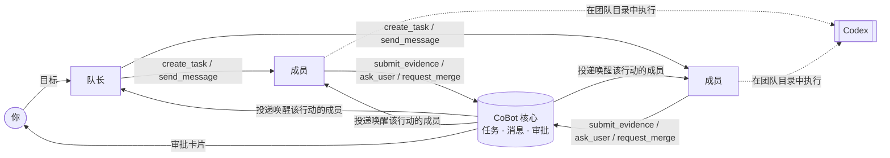

# CoBot

**Agent 干活，CoBot 带队。**

[English](README.md) · 简体中文

> **状态：早期预览。** Windows 本机 Web 版已经可以试用；桌面版和 macOS 版已能构建，
> 尚未实机验证。详见[当前状态](#当前状态)。

CoBot 是一个本地运行的应用，让多个 AI Agent 像团队一样协作。名字里的 **Co 是“合作”**：
CoBot 不想当一个更聪明的 Agent，而是 Agent 周围的团队组织。它管角色、任务、沟通、审批和共享记忆；
读代码、跑命令、改文件这些具体工作，交给外部 Agent（目前是 [Codex](https://github.com/openai/codex)）。

首个场景是编程，而且 CoBot 就是用 CoBot 开发的：它自己的 Agent 团队已经为本仓库规划、实现、
审查并交付了真实改动。

<!-- TODO：截图或短动图——团队列表、成员会话、审批卡片 -->

## 为什么需要 CoBot

一个编程 Agent 很好用。几个 Agent 同时做一个项目，很快就乱了：

- 谁在做什么说不清，两个 Agent 改同一处；
- “做完了”只是模型自己说做完了；
- Agent 之间互相唤醒、停不下来，额度烧光；
- 出了崩溃，搞不清到底执行了什么。

CoBot 用一个靠谱团队的方式解决这些问题：有队长拆任务，成员职责明确，有任务板，交付有证据，
关键决定由人拍板。

## 工作方式



1. **建团队**：选一个工作目录，生成队长和内置角色成员（产品经理、后端、前端、测试、代码审查），
   每个成员有自己的 Agent 会话。
2. **给队长一个目标**：队长拆成任务，写明负责人、依赖和验收标准。
3. **成员用结构化工具（MCP）协作**，不靠解析聊天。每个动作都成为 CoBot 数据库里的事实，
   再由事实唤醒下一个该行动的人。
4. **你始终掌控**：原生命令/文件审批、合并授权、有风险的协作循环，都会以卡片形式交给你。

## 功能

- **结构化协作**：19 个 MCP 工具，覆盖任务、消息、证据、转交、提问和合并申请。每次调用的身份由宿主绑定，
  模型无法冒充其他成员。
- **先有证据，才算完成**：只有队长或你能确认任务完成，而且必须附证据。合并申请绑定确切的候选提交、
  目标分支，以及与之相符的测试/审查证据；其中任何一项变化，原来的批准就不再算数。
- **人在回路中**：原生审批显示完整命令或 diff；Agent 可以向你提问，相关工作会等你回答。
- **防失控**：协作链有轮次上限，有风险的继续执行需要你确认，可选的用量预算会暂停新工作。
- **记忆**：每个成员有自己的记忆，跨会话保留。
- **诚实的恢复**：重启后核对真实发生了什么。执行结果不确定时，CoBot 会锁定并给出恢复卡，
  绝不猜测、偷偷重跑。
- **本地优先**：单个可执行文件，只监听本机回环地址，数据留在 `~/.cobot`。Agent 运行在私有 Codex 环境里，
  使用独立登录，和你日常的 Codex 互不影响。没有云服务。
- **Web 界面与桌面壳**：两者共用一个核心。界面支持中文和英文。

CoBot 不执行 shell 命令、不管理 Git，也不重写 Agent 循环。这些仍由你信任的 Agent 去做。

## 当前状态

| 平台 | 状态 |
| --- | --- |
| Windows 10/11 x64 · 本机 Web | **可以试用**，已用真实 Codex 端到端验证 |
| Windows 独立服务构建 | 可构建、可运行 |
| Windows 桌面壳（Wails/WebView2） | 可编译；尚未实机验证 |
| macOS（Web / 桌面） | 可构建；原生运行、签名与公证尚未验证 |

在 Windows 上用真实 Codex 验证过的内容：登录、多成员并行、任务交接与提问、原生文件审批与拒绝、
合并审批反馈、风险评估、断线重连、正常退出、崩溃恢复和升级。
最关键的一项是连续两轮 **用 CoBot 开发 CoBot**：每一轮都由队长规划、一名成员实现、另一名成员独立审查，
再由人批准确切的候选提交；第二轮运行在已经包含第一轮改动的升级版本上。

验证过不代表覆盖了所有边界情况。[验收复核](docs/首版验收复核-2026-10-15.md)把 94 个验收项逐项
区分为自动化、真实模型和未测。

## 快速开始

**前置条件**：Go 1.25+、Node.js 24+（npm 11+），已安装 [Codex CLI](https://github.com/openai/codex)
（已验证版本 0.161.0）。

```bash
git clone https://github.com/kunghim/CoBot.git
cd CoBot
npm ci --prefix frontend
./scripts/build.sh --target server        # Windows：powershell -File scripts/build.ps1 -Target server

.tmp/dist/cobot serve                     # 开发 profile，数据在 ~/.cobot-dev
```

打开终端里打印的一次性链接（60 秒内、仅一次有效）。需要新链接时，再运行一次 `cobot serve`，
它会为正在运行的实例打印一个新链接。然后：

1. **设置**：登录 Codex。CoBot 使用自己的私有 Codex 环境，需要在 CoBot 里登录一次。然后选择默认模型。
   设置页还会显示 CoBot 的原生安全 hook 是否已受信任。Codex 要求你用 `/hooks` 审查一次，
   具体步骤见[开发指南](docs/开发指南.md#codex-原生租约-hook)。
2. **新建团队**：选择工作目录和需要的成员。
3. **给队长发消息**，说明你想做什么。

日常使用请运行 `cobot serve --profile production`（数据在 `~/.cobot`）。启动链接要像密码一样对待。

## 参与开发

```bash
./scripts/dev.sh      # Go 核心 + Vite，自动授权               （Windows：scripts/dev.ps1）
./scripts/check.sh    # 格式、契约漂移、前端与 Go 测试         （Windows：scripts/check.ps1）
```

技术栈：Go · React + TypeScript + Vite · TanStack Query · Tailwind CSS · SQLite（modernc）+ goose ·
Wails v2 · HTTP JSON + SSE · MCP Go SDK。接口契约在 `api/openapi.yaml`，Go 和 TypeScript 类型均由它生成。

请先阅读[开发指南](docs/开发指南.md)、[CONTRIBUTING.md](CONTRIBUTING.md) 和 [AGENTS.md](AGENTS.md)。设计与验收文档在 [`docs/`](docs/)。

## 路线图

以下是打算探索的方向，不是承诺：

- 经过验证的 Windows / macOS 桌面版
- Codex 之外的更多 Agent 引擎
- 面向非编程工作的团队：办公、学习、写作与创作

## 许可证

尚未确定。在正式发布许可证之前，本仓库不授予任何许可。
