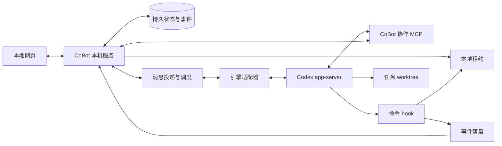
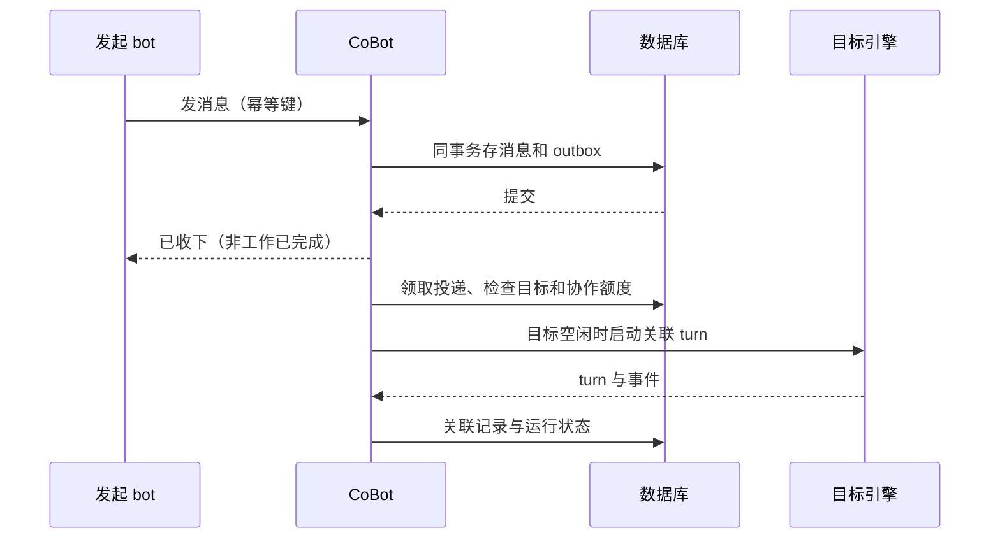

# CoBot 技术方案（持续讨论草案）

- 版本：0.1，2026-10-14；对应[需求文档](需求文档.md) R01～R17。
- 性质：当前方向与候选设计的整理，不是实现完成报告、最终接口规范或已确定技术栈。
- 已确认的是产品边界与若干架构方向；本文补出的模块、字段、状态和算法均标为设计建议，只有实测后才能把版本能力标为已验证。
- 历史与证据见[决策日志](决策日志.md)、[参考文档](参考/Codex-hook与崩溃降级.md)及[整理与迁移记录](整理与迁移记录.md)。

## 1. 架构职责与候选技术栈（T01）

**已确认方向。** Codex 负责一个 bot 内部的模型调用、工具执行与多步试错；CoBot 负责跨 bot 的身份、角色、任务、消息、审批、记忆、预算和恢复。协作动作提供为 MCP 工具，不解析回答中的文本标记。V1 是本机后台加本地网页。

图中模块代表职责，可以在一个后台进程内实现，不承诺微服务部署。只有数据库提交后的状态才能对外作为事实；网页是投影，不承担权限和一致性裁决。

| 层 | 候选 | 状态与选型条件 |
| --- | --- | --- |
| 后台 | TypeScript/Node.js，或 Python | 未定；比较进程管理、MCP、数据层、跨平台打包和开发成本 |
| 前端 | TypeScript + React/Vue 等 | 未定；以现有交互为验收输入，不按原型 HTML 自动决定框架 |
| 持久化 | SQLite 作为首选候选 | 未定；本机单实例便于部署，需验证事务、并发、恢复与迁移；不先承诺 ORM |
| UI 事件推送 | SSE 或 WebSocket | 未定；必须支持重连、游标和状态更新，避免重复渲染 |
| CoBot MCP | 本机 HTTP 服务或受管 stdio 入口 | 未定；需验证身份绑定、进程生命周期和 required 行为 |
| 记忆检索 | 基础字段/全文检索，之后考虑向量 | 未定；不为当前草案引入外部数据库或模型依赖 |
| 桌面壳 | V1 后评估 | V1 不做，不阻塞本地网页 |

选型应先通过 T16 小验证，再定框架和依赖。此轮没有安装、下载、生成产品脚手架或配置任何模型账号。

## 2. 模块与引擎无关协议（T02）

**建议。** 后台划分团队与目录、角色与权限、任务与交接、消息与投递、运行调度、审批、用量、记忆、事件投影、Git 工作区、引擎适配和恢复对账十二个职责。各层通过结构化对象连接。

引擎适配器建议提供：`capabilities`、`startThread`、`resumeThread`、`startTurn`、`steerTurn`、`interruptTurn`、`replyApproval`、`readState`、`close`。这是 CoBot 内部接口名，不是已实现 SDK；不支持的动作返回明确能力缺失，不能伪装成功。

统一事件至少区分：消息已收下、线程关联、轮次开始、文本增量、工具开始/完成、请求用户决定、轮次终结、用量、进程退出、连接丢失。终结必须保留成功、失败、被打断、未知等事实，不把所有 `turn/completed` 都当成业务完成。

Claude Code 类引擎保留宿主接入其工具循环的空间；模型厂商 API 类引擎以后需要 CoBot 驱动工具循环，或先限制成讨论/评审角色，不能假定只换 URL 就能接入。

Codex 自己的子 agent 不自动成为 CoBot 成员，也不绕过队长招募审批。其是否启用、如何计费、工具权限与跨团队限制，属于待验证/待讨论边界；V1 应避免出现用户看不到的第二套团队调度。

## 3. Codex 接入与版本证据（T03）

### 3.1 本次核对的事实

- 2026-10-14 本机只读执行 `codex --version`，输出 `codex-cli 0.161.0`。没有启动推理轮次，没有修改登录或配置。
- 官方 app-server 文档列出连接初始化、thread/turn 生命周期、流式事件和反向审批请求，并提供按所运行版本生成协议 schema 的命令。协议能力与本机版本仍应以探测为准。[官方 app-server 文档](https://learn.chatgpt.com/docs/app-server)
- 官方 hook 文档现已描述 `PreToolUse` 改写参数；这与 2026-10-13 的版本笔记不同。本机对应行为尚未复测。明确拒绝和 hook 信任仍是降级方案需要验证的前提。[官方 Hooks 文档](https://learn.chatgpt.com/docs/hooks)
- 官方 MCP 文档说明 `required` 初始化失败会阻止启动；运行中断连行为不能由这个配置推断。[官方 MCP 文档](https://learn.chatgpt.com/docs/extend/mcp?surface=cli)

以上是文档/版本核对，不是 CoBot 接入实验通过。旧笔记中的“已核实”只指当时调研，不自动等于当前所有版本的事实。

### 3.2 接入流程建议

1. 定位已安装的 CLI，记录准确版本与二进制身份。路径在本机配置中发现，共享文档不固定作者机器路径。
2. 候选传输为 stdio 的 NDJSON 请求/响应/通知；每次连接做 `initialize` → `initialized`，避免在握手前派工。
3. 创建或恢复 thread，持久关联 `bot_id`、引擎、`thread_id` 和工作区；创建 turn 前先记派发意图。
4. 持续读取事件：把请求、响应、通知分开处理；先提交必要的状态和 journal，再通知网页。
5. 用户追加消息是否 steer、排队或 interrupt，按待定产品语义映射，不因同名 RPC 存在就擅自改变用户工作。
6. native 工具审批映射到 CoBot 请求，等待用户后回复准确的服务端 request id；不重做整套 shell 和写文件工具以替代原生能力。
7. 协议不支持或参数不兼容时，停止依赖该能力的工作并记录，不能吞掉错误改走权限更宽的模式。

一 bot 一 thread 是候选映射；一 bot 一 app-server 进程、或一个进程管理多个 thread 都需评估。比较故障影响、成本、配置隔离和审批路由后决定，不把 Orca 的进程布局直接当成 CoBot 的硬要求。

### 3.3 凭据和配置

凭据只保留一份，不复制到团队目录、task worktree 或原型。共享登录与配置隔离是不同问题：不能为了每 bot 的 `CODEX_HOME` 隔离而复制 `auth.json`。候选为由单一受管凭据入口提供身份、配置按需要覆盖；API key 或订阅登录如何授权、进程间刷新锁如何处理，均待决定和验证。

安全 hook 的来源与内容需要可检查的信任过程。不能默认使用绕过 hook 信任、关闭沙箱或全权限执行参数。产品启动应能报告必需能力缺失，不自动重装 CLI 或改用户全局配置。

## 4. 数据模型与一致性（T04）

**建议的逻辑模型，尚未冻结表名或 SQL。** 所有具备团队语义的实体显式关联 `team_id`，服务端检查归属。

| 实体 | 主要字段 / 关联 | 关键约束 |
| --- | --- | --- |
| Team | id、名称、状态、实例 id、创建时间 | 每团队一个队长 |
| DirectoryBinding | team_id、规范化路径、目录身份、标记状态 | 路径唯一，创建时拒绝嵌套 |
| Bot / Role | team_id、角色、队长标志、成员状态、角色定义版本 | bot 不能兼属两团队 |
| Thread | bot_id、engine、engine_thread_id、工作区、能力快照 | 不混用其他成员历史 |
| Task | team_id、owner_id、父任务、状态、完成标准、证据、版本 | 唯一有效负责人 |
| Transfer | task_id、旧/新负责人、提议与接受时间、状态 | 接受时检查当前 owner 和任务版本 |
| Message | id、team_id、from/to、正文、用户/协作类型、父消息 | 客户端请求号防重复提交 |
| Delivery / Outbox | message_id、目标 bot、派发状态、尝试、幂等键 | 消息入库和待投递行同事务 |
| Run / Turn | bot、thread、task、chain、turn id、状态、执行代际 | 不把“已发送”写成“已完成” |
| ApprovalRequest | 发起者、task/turn/item、类型、动作摘要、原选项、状态 | 引擎连接代际 + request id 防串单 |
| ApprovalDecision | request、选择、附言、用户/系统来源、入口、时间 | 一请求只有一次有效决定 |
| ApprovalResponseOutbox | decision、连接代际、发送/确认状态 | 用户决定与引擎送达分开记录 |
| CollaborationChain | root、epoch、计数、上限、风险区、状态 | 唤醒和计轮原子、重复消息不重复计轮 |
| MemoryFact | bot、team、内容、来源、时间、删除标记 | 按 bot/team 检索，删除有一致策略 |
| UsageLedger | bot/team/run、事件编号、token 分类、来源 | 事件去重，未知不写成零 |
| EventJournal | id、顺序号、对象版本、team、相关 bot、类型 | 可重放，网页游标稳定 |
| Workspace | task、branch、worktree、base/head、状态 | 同团队子工作区，不当成独立新团队 |
| RecoveryCase | run、依据、结论、冲突、用户选择 | 不确定不自动重跑 |
| HookEventImport | event id、时间、执行代际、导入状态 | 实时与落盘重复可去重 |

需要事务的操作：团队绑定与队长创建；成员招募批准与成员激活；消息与 outbox 写入；唤醒与计轮；交接接受与负责人更换；审批决定与待响应记录；用量去重与账本；恢复导入与状态更新。

实体增加 `revision` 或等价并发控制；请求带期望版本。写冲突返回当前事实，由用户或调度器重新判断，不默默覆盖。数据结构迁移必须有版本、备份/恢复策略，具体工具待选型。

## 5. 目录绑定与团队生命周期（T05）

绑定创建建议先校验、再事务保留目录、再写标记；数据库和文件不能组成同一个原子事务，需记录“绑定待写标记”状态并支持重试。标记写失败不应放出第二个队长；UI 不宣称完整创建成功。

规范化包括真实路径、链接/联接解析、Windows 大小写规则、分隔符与边界。嵌套比较按路径组成部分进行，不能用简单字符串前缀把 `foo` 与 `foobar` 误判。无法可靠解析目录时显式拒绝本次绑定，而非猜路径。

`.cobot` 标记候选字段为 schema_version、team_id、instance_id、创建路径/时间；它是提示与对账材料，不是可直接信任的授权文件。移除标记不解除数据库绑定。foreign/copy/move 走需求 R01 的用户选择，移动后仍检查冲突。

worktree 的 `.git` 可能是文件，应通过 Git 查询实际 Git 目录和本机排除位置，不能假定 `.git/info/exclude` 总能直接拼路径。任务 worktree 登记为本团队的工作区，不参与“再建团队”的自动创建；目录嵌套限制与任务工作区布局要统一处理。

建议同一目录范围一次只允许一个写入型 CoBot 实例接管；实例锁、跨实例数据库丢失后的恢复及标记接管都待验证。只在一份数据库设置 UNIQUE 不能证明多个独立实例之间绝无重复团队。

归档/删除先处理活跃 run、待审批、交接和 worktree。删除代码不属于删除团队；未提交代码、未合并分支的清理仍须用户明确决定。具体生命周期流程属于 Q06。

## 6. 角色、任务与结构化协作工具（T06）

候选工具名仅用于说明职责，不是已经发布的 MCP API：

| 工具职责 | 输入概要 | 服务端条件 |
| --- | --- | --- |
| `send_message` | target_bot、内容、关联任务、幂等键 | 同团队、目标有效；from 由受管身份确定 |
| `create_task` / `assign_task` | 描述、完成标准、目标负责人 | 队长权限；用户管理走独立入口 |
| `update_task` / `submit_evidence` | task、期望版本、进展或证据 | 当前任务负责人，或用户授权管理 |
| `propose_task` | 任务建议与理由 | 成员只能提议，队长确认后建任务 |
| `offer_transfer` / `accept_transfer` | task、目标、交接说明 | 原 owner 发起；目标接受，事务更新 |
| `report_completion` | task、完成结论、证据 | 先验证 owner 与证据，不能直接等于用户验收 |
| `request_member` | 内置角色、理由 | 仅队长，建立待用户批准请求 |
| `ask_user` | 一个具体问题、可选项、关联工作 | 类型区分提问与审批，返回等待状态 |

身份由启动时的受管连接/会话绑定验证，不信任模型在参数中自报 `team_id`、角色或权限。只给每个 bot 暴露必要工具；即使模型猜出其他 ID，后台也必须拒绝跨团队操作。

角色库以文件存放是候选；每轮注入已存在的团队名单、本人职责与当前任务事实。队长额外拿完整内置角色库。名单更新不是一条需要唤醒全员的工作消息。

任务交接接受使用任务版本和当前 owner 校验；超时、目标被移除、任务已结束或被另一次交接变更时应拒绝接受并保留原因。把交接通知、结果和任务更新串成一个可恢复流程。

## 7. 消息投递、排队与轮次（T07）

建议按目标 bot 串行 drain：忙时保留队列，当前轮终结后再领取下一项。引擎断开不能让 outbox 丢失。跨 bot 任务可以并行，但同一目标的忙闲裁决、计轮和派发只允许一个调度 owner。

**边界：** 数据库“已发出”和外部引擎“已接受”没有天然原子性。消息可能已被 Codex 接受而回执未落库。不能把 outbox 的至少一次投递误说成所有工具副作用恰好一次。需要引擎关联 ID、线程记录或能力支持做对账；不确定派发先进入恢复，不能盲目重发一轮。

内部链候选字段为 root_message_id、parent_message_id、epoch、wake_count。领取派发时检查上限并计数，重复投递同一次唤醒不重复计轮。用户插话开启新 epoch 或新链，如何处理正在运行和已有队列仍需 Q09/Q11 决定；不能简单把数据库计数归零同时继续旧授权。

风险区候选为最后 20%，需明确向上/向下取整、短链和并发唤醒语义。小模型返回继续、请求确认或明确无法判断；无法判断如何处理属于产品选择，默认不得扩大高风险权限。到硬上限不因评估模型故障而放行。

可持久记录“不回复/无需继续”、跳过、取消、超时、失败等终结，避免 bot 为结束协作而不断互相确认。这来自 G2 的候选借鉴，不视为已冻结枚举。

## 8. 审批状态与执行语义（T08）

一项审批只有一个后台请求；队长会话和发起者会话是同一请求的两个投影。分页状态是界面本地状态，后台请求顺序和决定不因翻页改变。

建议分开三件事：`request_state`（pending/decided/invalidated）、`decision`（具体选择）、`response_state`（待送/已送/已确认/未知），再关联 `execution_state`（未开始/在跑/完成/拒绝/失败/未知）。用户点击允许只证明决定已存，不证明命令已执行成功。

1. 收到原生审批或协作确认后，持久记录动作、申请者、request/thread/turn/item、连接代际和当时选项。
2. 用户决策接口校验身份、可选项、请求版本及仍有效；用条件更新争抢一次有效决定。
3. 同事务存决定与响应 outbox。提交后所有 UI 移除 pending 卡，并在“审批”页展示已处理记录；执行/送达状态可继续更新。
4. 适配器仅向对应连接代际与原 request id 回复。收到确认后更新送达状态；连接丢失标未知，不把老 request id 回复给新进程。
5. 对账确认引擎仍等待且具有可重新关联请求时恢复；否则不能声称审批响应已经生效。

“总是允许（这个 bot）”是拟议的常驻规则，不等于 app-server 任意 session 级授权。匹配的工具、目录、动作和寿命需冻结；不支持精确范围时不要用更宽授权冒充。合并、跨目录、招募等权限不能被一次命令批准顺带授予。

历史存选项快照，不按当前 UI 重新生成过去选项。人工处理和自动规则放行的来源分开。系统取消、超时和失效是否进入用户“审批”页待 Q08 决定，内部 journal 始终保留；后台待审批不是用户历史。

风险分级、命令解析、不可审批禁止名单和网络授权来自 G8/G15/G16 候选，不已经落定。命令文本解析不能替代沙箱；PowerShell、重定向、子进程和脚本间接执行等必须覆盖后才谈统一规则。

## 9. Git 工作区与合并（T09）

每个编码任务记录基线提交、分支、worktree、当前 head、修改摘要和证据版本。建议在应用数据/受管工作区保存路径清单，与用户团队根目录分开；具体落点不固定到作者机器，也不在文档创建真实目录布局。

创建分支/worktree 前确认基线与已有改动；失败记录可恢复状态，不自动 reset/stash 或覆盖用户文件。共享依赖、锁文件、端口、数据库和测试资源是否隔离，需要在实现阶段明确，单有 worktree 不证明所有副作用都隔离。

测试与审查引用候选提交 SHA；合并批准绑定源 head、目标 head 和证据。如果源或目标变化，重做核对与必要审批。用户批准后由谁执行 merge、如何冲突回退、是否建远程 PR 属于建议，尚未授权本次去创建真实分支或合并。

任务结束后不自动删除未提交代码或未合并分支。清理保留期和用户确认流程待定。

## 10. 记忆、用量与预算（T10）

记忆事实候选保留内容、来源任务/轮次、时间、bot/team 与删除标记。检索时先按归属筛选，再匹配相关性；模型不能提供另一个团队 ID 来绕过过滤。删除与下一次提炼应有 tombstone 或等价策略，避免刚删掉又被原聊天自动重建。团队共享事实未采纳，不先实现全局库。

用量采用事件去重的账本，区分输入、输出、缓存、来源与统计口径；无法从引擎拿到的费用或 token 标未知。金额估算、订阅额度与请求实际费用不是同一指标，未决定前不绑定价格表或宣称能读取所有余额。

预算门禁优先阻止启动新的协作轮次，运行中的默认允许完成，这是现有清单建议。hook 租约若把预算耗尽解释成中途拒绝所有工具，会与该行为冲突：需明确“禁止新轮”和“运行中紧急暂停”两类状态，不能共用一个 allow 位而误停工作。

并发轮次可以造成预算超量，候选使用启动预留与结束结算，预留额度和超量容忍待讨论。风险评估模型调用也计账。账本与轮次限制在 CoBot 重启后不能清零。

## 11. 事件投影与界面一致性（T11）

事件 journal 建议提供顺序号、对象 revision 和游标；浏览器重连从已确认游标补齐。事件先提交，再通知 UI。快照和增量要有统一版本边界，避免先收删除卡再收旧快照导致卡片复活。

用户网页可看团队事实；“卡片不给其他 bot”指模型上下文投递范围，不意味着用户切页面无权查看。服务端分别提供队长团队投影与成员职责投影，不只由前端过滤全部数据。

当前 UI 需要独立保存一级页面、二级列表展开、当前 team/bot、右侧入口、右侧展开、沟通详情和待审批卡选择。切成员保留入口但清详情；审批卡选择引用 request id，而非永久数组下标。决定后移除、重新计算分母；新增请求不自动换走用户正在阅读的卡。

右侧“审批”查询条件只取已处理记录，不返回 pending 操作。历史选项是只读标签。输入框状态行排除“等你审批”，等待状态留在列表。左右恢复图标在会话/看板头部仍可访问；首页按钮不兼任列表开关。

本机网页服务建议限制回环访问、验证 origin 与会话身份，避免网页或 MCP 请求自报身份执行动作。端口、认证方式和跨平台浏览器支持待定，不做服务器暴露和多机访问。

## 12. 启动对账与崩溃恢复（T12）

建议启动次序：实例锁与存储版本检查 → 导入 hook 落盘 → 查询未终结 run/待响应决定 → 检查引擎进程与线程状态 → 核对分支改动 → 写恢复结论 → 只恢复确定可安全续送的工作。

| 证据 | 处理建议 |
| --- | --- |
| 从未发送的消息 | 检查权限与额度后续送 |
| 引擎可证明 turn 已完成 | 补记结果、用量与后续状态；成功不等于任务验收完成 |
| 引擎可证明仍在运行 | 重连/重新订阅能力经验证后跟踪；不能再启动同一轮 |
| 已中断且可恢复 | 队长卡片给出继续、重跑或放弃，附工作区变化 |
| 数据库称已发送，但无可证明的线程/事件 | 标未知/失联待核对，由用户决定 |
| 用户已决定，响应送达未知 | 保留决定，对原引擎请求对账，不冒充命令已执行 |
| 旧请求已失效 | 内部记系统终止；不能只凭宿主退出写“命令未执行” |

分支有改动只证明存在文件变化，不能证明对应命令或 turn 完成。线程记录与事件冲突时保留双方证据、版本与时间，标冲突待核对。不能依赖最后一条自然语言“做完了”单独作终结事实。

重跑可能产生重复外部副作用，恢复卡应明确已有证据与未知部分；自动恢复只限能够证明不会重复工作的路径。schema 变化或记录缺失不能被当成没有工作发生。

## 13. hook 租约与事件落盘（T13）

**已确认方向，未验证安全保证。** CoBot 在线时更新本地租约，命令 hook 本地判断是否允许；离线或不允许时明确拒绝；事件在线转发失败就落盘，启动导入。MCP 连不上不是保护机制，因为工具闸门必须在本地执行而不是依赖调用已经离线的宿主。

建议租约包含实例/进程代际、心跳、过期时间、bot/run 归属、允许动作范围及拒绝原因。文件原子替换；不只检查 PID，避免 PID 重用误认新进程。墙钟改变、读取失败、部分写入与陌生代际都要有确定策略。

“仍能读文件”不能简单等于“允许运行任意 shell 读取命令”；读取工具和有副作用命令必须按实际工具输入与权限区分。路径闸门对间接 shell 副作用的能力有限；hook 配合沙箱与进程监督，不能声称可拦住已运行命令或所有未经验证工具。

事件文件建议每事件一份 JSON，临时写入后原子改名，位于应用数据目录、按 bot 分组。包含 schema、event id、bot/thread/turn/tool-call 关联、代际、时间、脱敏摘要。仅用事件类型与轮次组合无法区分同一轮多次同型事件；要包含调用号或事件唯一序号。

不写原始文件内容或凭据。最后回复、命令、工具参数也可能带敏感内容，候选采用允许字段列表与脱敏，不能因为“元数据”就假设安全。文件访问权限、并发写入、容量不足和损坏文件隔离需要测试。

参考容量 5 MB、保留 7 天、在线发送等待约半秒来自历史参考，不是已经确认的产品参数。超限不能静默覆盖唯一恢复证据；记录事件缺口并降级为不确定对账。实时事件与落盘导入使用同一幂等键，导入成功后才归档/删除原文件。

**原方案的局限必须保留：** 未受信任的 hook 可跳过，脚本崩溃和部分错误语义可能放行；租约已过期也无法撤销先前副作用。无法覆盖的情况不得宣传成硬性离线隔离。若小验证证明 app-server 随宿主一起停止，hook 的崩溃用途缩小，仍可用于宿主卡死及在线门禁；正常退出和强制崩溃的策略需分别讨论。

## 14. 失败分类与可观察性（T14）

建议错误至少区分无权限/跨团队、对象缺失、目录冲突、目标忙、额度阻断、审批等待、协议不支持、引擎退出、请求超时、事件缺失和状态未知。前端显示可操作的原因，内部保留关联 ID 与事实，不把所有问题归为模型失败。

日志关联 team、bot、task、message、run、approval、engine epoch 和 event id；默认不记凭据值、完整环境或未脱敏参数。UI 可以隐藏轮数，后台仍要保留真正触发原因供恢复和审计。

在场感知、空闲释放进程（G19）仍是候选优化，不能因用户离开就暂停当前软件开发任务；资源节约策略不能改变已确认的运行方式。

## 15. 验收映射（T15）

以下均为未来实现验证，不是本次通过的测试。文档整理验证另见迁移记录。

| 需求 | 设计承接 | 需要的证据 |
| --- | --- | --- |
| R01 | T04、T05 | 路径别名、嵌套、删标记、复制/搬家、失败回滚和实例冲突实验 |
| R02 | T02、T06 | 越权请求拒绝、招募审批、名单下一轮更新、移除任务交接 |
| R03 | T06、T07 | 跨团队拒绝、目标忙队列、重放、发送应答缺失的对账 |
| R04 | T04、T06 | owner 事务、同时交接、状态/证据回写 |
| R05 | T09 | 双任务隔离、同版测试审查、合并 head 变化和冲突 |
| R06 | T08、T11 | 双入口并发决定、分页、原选项快照、响应送达未知 |
| R07 | T07、T10 | 并发唤醒、幂等计轮、重启、硬上限与新 epoch |
| R08 | T10 | 归属检索、删除与再提炼、上下文隔离 |
| R09 | T10 | 去重账本、未知用量、并发额度、新轮与运行中区别 |
| R10 | T02、T03 | 精确版本接入、能力探测、凭据并发、steer/interrupt |
| R11 | T12 | 各崩溃点、证据冲突、恢复重复与未知状态 |
| R12 | T13、T16 | hook 信任、拒绝、异常、断连、落盘与已运行子进程 |
| R13～R16 | T11 | 桌面/窄屏、列表和面板独立收起、成员范围与信息减重 |
| R17 | T01～T16 | 开发 CoBot 的完整闭环与权限/恢复证明 |

## 16. app-server 小验证清单（T16）

此次只落清单，未执行会消耗额度或修改配置的实验。实验需记录 CLI 版本、协议 schema、平台、步骤、事件日志、可观察结果与结论；成功一次不证明所有工具/平台覆盖。

| 编号 | 验证内容 | 通过或回到讨论的依据 |
| --- | --- | --- |
| S01 基础协议 | 握手、thread start/resume、turn 事件与状态；生成目标版本 schema | 关联 ID 与终结事实准确，能力缺失明确 |
| S02 宿主与子进程（原前提 1） | 正常关闭、强制结束、卡死时 app-server 与它启动的命令是否存活 | 得到真实进程树/退出证据，分别设计监督与恢复 |
| S03 hook 信任（原前提 2） | 受管配置下列出、授予/撤销与改动后重新信任 | 必需 hook 生效可证明；不依赖危险绕过 |
| S04 工具覆盖（原前提 3） | shell、改文件、读取、MCP、嵌套工具和子 agent 的前置 hook | 拦截范围有列表与证据，未覆盖明确列出 |
| S05 Windows 开销（原前提 4） | hook 正常、离线、磁盘慢、脚本异常/超时的延迟 | 阻断语义与性能实测；目标阈值待决定 |
| S06 required MCP（原前提 5） | 初始化失败及运行中断连、恢复连接 | 不把启动失败语义推断为中途强制停止 |
| S07 审批原生能力 | 命令、文件、网络批准/拒绝、规则范围和失效 | 卡片选项可以准确映射，没有扩大权限 |
| S08 在途崩溃与恢复 | turn/start 已接受但 DB 未关联；决定已存但响应未确认 | 对账能避免盲目重放，未知清楚表达 |
| S09 事件落盘 | 并发、重复、部分文件、超量、无空间、导入中断 | 去重成立、缺口明确、已导入与未导入不混淆 |
| S10 凭据与配置 | 多 bot 并行、登录刷新、共享身份和配置隔离 | 凭据单份且不污染团队目录，权限按 bot 正确路由 |
| S11 工作区与实例 | worktree Git 路径、目录链接、两个实例抢同目录 | 绑定和任务隔离成立，失败可恢复 |
| S12 引导与打断 | steer、interrupt、轮次终结后排队以及子 agent 边界 | 产品语义明确，未验证功能不可静默回落 |

只要 S02～S06 的关键前提不成立，“不停但降级”仍是设计意图。先报告不可满足的具体条件，再决定修改方向；不能为了推进实现擅自删掉恢复或隔离要求。

## 17. 后续实施顺序与未决项（T17）

建议顺序：协议/生命周期小验证 → 决定技术栈与能力基线 → 数据与团队绑定 → 消息/权限/调度 → native 审批闭环 → 任务工作区与测试审查 → 恢复与预算 → 记忆和界面联调 → R17 自举验收。此顺序供后续讨论，不是当前开发授权。

尚未确定：进程复用布局、MCP 传输、数据库/ORM、RPC/事件/工具具体 schema、应用数据目录规范、凭据接入、预算模型、风险判断模型、角色上限、常驻授权与命令风险规则、失效请求展示、合并/清理策略、平台最低版本、许可证和分发方式。

文档更新时先改产品结论，再改对应 T 章节与实验清单。接口草案不能反向把尚未确认的产品细节变成既定需求。
