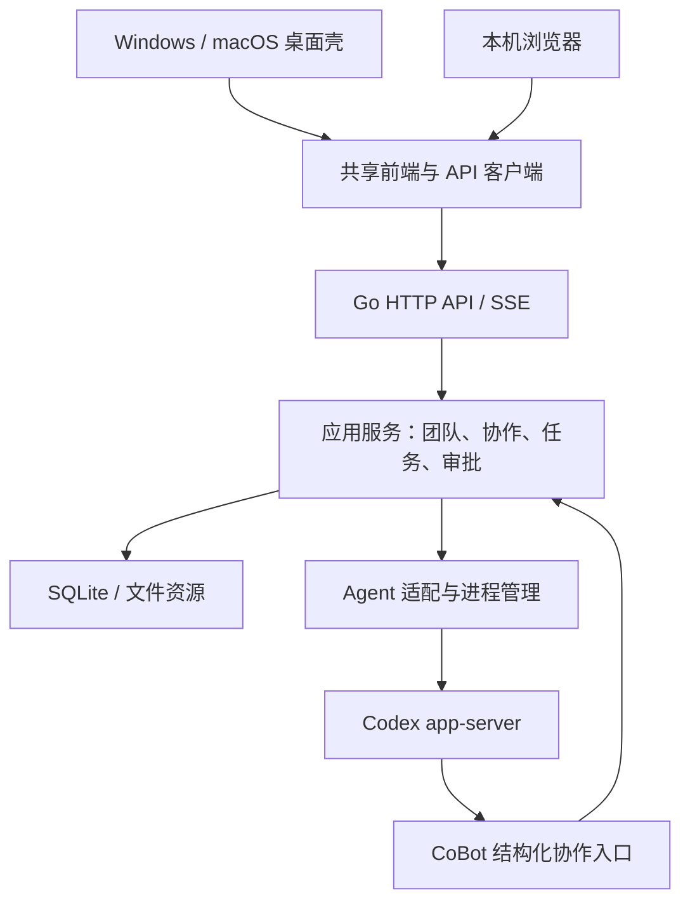

# CoBot 首版技术选型与架构设计

- 日期：2026-10-14；版本：0.3。
- 状态：架构建议与审查后的讨论草案，不是最终规格、实施完成报告或范围冻结。
- 目标：轻量、可靠、易贡献，支持 Windows、macOS 客户端及本机 Web，为后续版本保留清晰扩展边界。
- 文档关系：承接[需求文档](需求文档.md)与[技术方案](技术方案.md)。本文新增候选细则不自动覆盖已有用户决定；差异见第 8 节。
- 编码实施入口（2026-10-15）：[首版开发方案](首版开发方案.md)、[目录架构](首版目录架构.md)与[验收清单](首版验收清单.md)。其工程默认值承接本文及旧文档的未定实现细则，不能擅自撤销用户已确认规则。
- 本轮记录前已核对当前仓库：工作区干净，尚处于需求与实验阶段。方案制定时因读取工具故障未核仓库；本次落档通过获准的只读命令完成核对。子 Agent 审查基于设计文本，不是代码或运行审查。

## 1. 定位、已确认方向与选择状态

CoBot 是本地运行的通用多 Agent 协同应用。编程是首个场景，未来可扩展办公、学习和创作。CoBot 管角色、任务、沟通、上下文、审批与持久事实；外部完整 Agent 执行模型/工具循环及具体业务操作。

用 CoBot 开发 CoBot 是首版真实交付目标：拆任务、协作实现、测试、审查、用户授权交付，再用交付版本继续开发。开发测试可只启动开发服务，通过 Web 检查，无需同时运行生产实例。

| 项目 | 状态 | 结论 |
| --- | --- | --- |
| 通用多 Agent 定位、Go 后端、本地运行 | 已确认 | 不把核心永久绑定编程、Git 或某个供应商 |
| Windows/macOS 客户端与本机 Web | 已确认支持方向 | 各平台实际发行与验收仍需实施；不将编译成功等同于可用 |
| 开发/生产隔离 | 已确认 | 开发 `~/.cobot-dev`，生产 `~/.cobot` |
| 首版先接 Codex | 已确认方向 | 不写 Claude 空实现，不重建外部 Agent 的工具循环 |
| 私有环境独立官方登录 | 本轮用户已确认 | 接受在 CoBot 私有环境重新官方登录，不依赖内部令牌复用接口 |
| 开源许可证 | 本轮用户明确暂缓 | 不阻塞本地开发，公开发布前必须确定 |
| 正常退出与 Git 排除 | 用户已确认 | 正常退出停止自有服务及受管执行；保留 `.git/info/exclude` 本地排除 |
| 三项接入前提 | 用户确认已经处理 | 桌面通信、私有登录、多团队并行不再安排开发前重复验证；不冒充本仓实测 |
| 本文其余技术栈与实现细则 | 架构建议 | 不是因“记录成文档”而全部转为已确认 |

不建设 CoBot 云端业务服务。本机 Web 仅访问本机服务；未来远程访问只讨论边界，不列为已确认路线或首版功能。

## 2. 总体架构与技术选型

采用 **Go 模块化单体 + 共享 Web 前端 + 桌面薄壳 + 外部 Agent 适配器**。

图中模块不要求成为独立服务。首版不引入微服务、Redis、动态插件平台、工作流 DSL、独立消息中间件或运行时 Node.js 服务。

| 部分 | 建议选型 | 理由与边界 |
| --- | --- | --- |
| 后端 | Go；标准库 `net/http`、`context`、`log/slog` | 减少框架依赖；普通模块与显式组合，不引入 DI 框架 |
| 桌面 | Wails v2 稳定线 | Go 原生宿主与共享 Web UI；不依赖 v3 Beta 能力 |
| 前端 | React、TypeScript、Vite | 交互生态成熟，便于开放贡献 |
| 路由与服务状态 | React Router Declarative Mode、TanStack Query | 客户端路由与服务数据分开；不用 Framework Mode 或另一套 loader 数据管理 |
| 样式与组件 | Tailwind CSS、按需 Radix、Lucide | 统一样式与可访问性，不搬入整套大型组件系统 |
| 数据库 | SQLite、`database/sql`、`modernc.org/sqlite` | 本地无数据库服务；驱动无需 CGO，但桌面宿主仍有平台构建要求 |
| 迁移 | goose 库模式、嵌入编号 SQL | 记录版本、顺序升级，不自写 runner，不引入 ORM |
| 接口与事件 | HTTP JSON + 基于 `fetch` 的 SSE | 命令、查询、事件分离；没有真实需求前不加 WebSocket |
| 国际化 | i18next、react-i18next、`Intl` | 中文、英文首版覆盖；本地化日期、数字与复数 |
| 测试 | Go 测试、Vitest、Playwright、原生安装烟测 | 分别覆盖业务、交互、浏览器闭环与平台差异 |

实施时锁定稳定版本并提交依赖锁文件，发布不使用浮动 `latest`。不在尚未核对依赖兼容性时冻结具体补丁版本。

Wails v2 官方说明覆盖 Windows/macOS；Windows 依赖 WebView2。安装包应处理缺失运行时，不能假定用户已安装开发环境。选择 v2 而非当前 Beta 的 v3 是可靠性优先的建议。[Wails 安装说明](https://wails.io/docs/gettingstarted/installation/)、[Windows 运行时说明](https://v2.wails.io/docs/guides/windows/)

`modernc.org/sqlite` 是无 CGO 驱动，这不等于整个桌面项目没有平台工具链要求。[驱动官方仓库](https://github.com/modernc-org/sqlite)

### 2.1 运行入口与所有权

- 独立服务入口和桌面入口共用一个应用启动模块。
- 同一环境只允许一个业务核心持有数据库、调度器与进程管理器。
- 桌面遇到已有同环境服务时复用，不能再启动第二套核心。
- 桌面连接独立服务时，关闭窗口不停止该服务。
- 已确认：正常退出桌面应用时，停止其自己启动的服务及受管执行；正常退出独立服务时同样停止该服务管理的执行。
- 意外崩溃仍沿用“不停但降级”方向，具体保证随开发验证；不得以正常退出规则撤销崩溃降级需求。
- Web 静态资源嵌入 Go 服务；生产无需 Node.js daemon。
- 默认监听 `127.0.0.1` 动态端口，使用受控实例发现；锁持有整个服务生命周期，不仅检查 PID 或端口。

## 3. 模块边界与数据所有权

| 模块 | 职责 |
| --- | --- |
| 应用服务 | 团队、成员、任务、对话、审批、协作状态转换 |
| Agent 适配 | 外部协议、会话映射、执行事件、能力差异 |
| 基础设施 | SQLite、文件资源、HTTP、事件流、进程、路径处理 |
| 桌面宿主 | 窗口、原生目录选择、启动授权、生命周期 |

核心不导入 Wails。适配器不直接访问业务数据库，应用层接收适配器事件并提交状态。前端业务统一走 HTTP；Wails 绑定只负责平台能力和启动握手。

### 3.1 核心对象

| 对象 | 定义与关系 |
| --- | --- |
| Team | 协作范围，持有成员、工作目录与团队设置 |
| Bot | 成员身份和执行配置，不等同于外部进程 |
| Conversation | CoBot 自己保存的交流记录，与外部会话通过映射关联 |
| Task | 团队工作项，关联负责人、状态与完成证据 |
| Run | 一次执行，关联触发消息、任务和外部终止结果 |
| Approval | 执行或协作中的待决事项；保存决策和响应送达状态 |
| Artifact | 文件等产物引用；首版不建设独立成果管理平台 |

以上是逻辑概念，不要求每项分别建仓储、服务框架或独立模块。已有任务交接、记忆、预算、风险区和角色需求继续以需求文档为准，本表不是删减功能清单。

CoBot 数据库保存协作事实；外部 Codex home 保存其会话与凭据。CoBot 不直接读写 Codex 数据库。重建外部 thread 不删除 CoBot 历史。

首版消息只定义实际需要的文本、产物引用、审批引用块。未知类型显示安全占位，不执行其中动作；不建设任意 JSON 内容插件系统。

### 3.2 目录与环境

开发根 `~/.cobot-dev`，生产根 `~/.cobot`。数据库、Codex 私有 home、凭据、缓存、日志、实例锁、启动信息与 WebView 用户数据隔离。不得通过改变用户全局环境变量切换。

候选引擎根：生产 `~/.cobot/engines/codex`，开发 `~/.cobot-dev/engines/codex`。路径是正式实现建议；此前实验只创建临时根。

团队仍需选择工作目录，默认工作区提供可直接选择的位置。目录信息对全部成员可见，目录中的 `.cobot` 保存交互资源和目录识别信息，不成为第二套业务状态库。

目录唯一绑定、禁止嵌套、数据库为绑定事实来源等已确认规则保留。删除 `.cobot` 不解除绑定；路径、复制和搬家问题不能静默改绑。

首版不内置 Git 管理、提交或工作树创建。外部 Agent 负责业务 Git 操作。用户确认保留自有 `.cobot` 资源的本地排除：检测到 Git 仓库时加入 `.git/info/exclude`，不改共享 `.gitignore`，不提交代码。应核对实际 Git 目录以兼容 `.git` 为文件的 worktree，不直接拼接路径；普通目录无需 Git。此前完全取消自动排除的建议撤回。

## 4. 协作调度、执行与可靠性

### 4.1 外部引擎

当前方向为每团队一个 Codex app-server、每 Bot 独立 thread，由环境级 EngineManager 管理。

- 团队进程按需启动；无运行和待审批时才允许闲置关闭。
- 同一 Bot 同时一个 turn；不同 Bot 可以并行。
- 团队队列只串行短状态转换，模型执行异步进行，完成事件回到队列。
- RPC、通知、审批按 request/thread/turn 与连接代际关联，不按到达顺序猜测归属。
- 中断一个 Bot 不停止整个团队进程。
- 适配器终止事件确认 Run 结束；后台接受协作动作确认 Task 状态，不靠模型文字判断完成。
- 结构化协作入口绑定受管身份，校验团队、角色和对象归属，不相信模型自己填写 from。
- 有未完成任务或正在执行时禁止删除 Bot。
- 模型、用量和能力以实际引擎查询及事件为准；未知用量不记为零，不添加最低预算规则。

首版只做实际 Codex 适配，不写 Claude 空实现。恢复、模型枚举、审批、中断等能力可选，不要求所有未来 Agent 都完整实现 Codex 语义。仅模型 API 不是完整 Agent，不默认由 CoBot 重建执行循环。

进程启动避免 shell 字符串拼接；平台封装负责启动、优雅停止及超时停止。Windows Job Object、macOS 进程组的生命周期和后代控制范围随开发集成检查；不承诺控制任意主动脱离进程组的程序。不得无条件设置“宿主退出即杀全部子进程”，否则会与意外崩溃后保留执行并降级的方向冲突；正常退出由应用显式停止自己管理的执行，崩溃策略另行实现。

### 4.2 消息与持久化

SQLite 候选配置：WAL、外键、FULL 同步、短事务、有界 busy timeout、集中连接初始化和受控单写入口。连接级设置必须对实际连接生效，迁移先于业务请求。

WAL 可使读写并行，但仍只有一个写入者，不能把它误解为无限并发写入。[SQLite WAL 文档](https://www.sqlite.org/wal.html)

- 消息先持久化，再唤醒或排队；消息和待投递意图同事务保存。
- 关键状态与对应持久业务事件同事务提交。
- 流式文本用于显示，分批保存消息；不逐 token 写业务事件表。
- 快照和 sequence 在同一读事务取得；SSE 从其后补发，实时接续保持连续。
- 客户端按 sequence 去重，游标过期则重新取快照。
- 共享流管理器负责重连、有限退避、401、续期与关闭；组件不各开一条流。
- 慢客户端缓冲有界，断开后同步，不能阻塞引擎。
- 页面断开不停止后台任务。
- 重启仅继续确定未发送的消息；不确定执行标记中断或待核对，不自动重放副作用。

上述机制通过普通业务状态、事件表和事务实现，不建设事件溯源框架。完整崩溃降级不是开发前最大阻塞，已有降级需求也不因精简而撤销。

### 4.2.1 数据库升级与备份

迁移用于版本升级时增加表、字段、索引或转换已有数据，不是搬工作目录，也不修改 Codex 会话库。

- 使用 goose 库模式与嵌入 SQL，记录版本并依次执行；全新数据库执行初始化迁移。由 modernc 驱动打开 `*sql.DB`，再交给 goose 的 SQLite 方言 provider，区分驱动注册名与迁移方言，不另建一套连接。
- 服务取得环境实例锁后、接收业务请求前完成迁移；升级已有数据库前保存一致性备份。
- 备份使用 SQLite 一致性备份机制，或在关闭所有连接后复制完整数据库状态；不得直接复制运行中的主文件而遗漏 WAL。
- 正常升级仅自动向前，失败停止启动并保留诊断和备份。不自动运行 down；回退使用兼容旧版本的升级前备份。
- 随实现检查旧数据保留、重复启动、迁移失败和备份恢复，不单独设为开发前实验。

### 4.2.2 日志与容量

采用结构化日志，关联团队、Bot、Run 和请求标识；日志轮转、保留数量及总容量有上限。凭据、启动秘密和授权头脱敏，默认不记录完整提示词和文件正文。开发/生产分别存放，不因诊断写入敏感值。首版提供本机错误定位能力，不引入集中日志服务。

### 4.3 审批

分别记录用户决策保存、响应发送、引擎继续执行确认，以及未知或失效状态。CAS 防止两窗口同时做出不同决策；重复点击复用已有决策，不重复发送。发送失败不能误报为引擎已接受。

会话待审批单卡翻页，处理后移出；审批页保留名称，仅展示已处理历史与实际结果。不重复显示“待你处理 N”“还有一张”或输入框“等你审批”。既有请求归属、队长/成员可见范围以界面布局为准。

面板、列表使用带可访问名称的图标收起。一级导航首版只展示实现功能，不提前摆搜索、定时任务等占位。方案此前提及团队四页不作为撤销现有按 Bot 切换面板的依据。

### 4.4 正常退出、中断与重启接管

以下行为已获用户同意，随实际功能开发验收，不新增开发前实验。

| 场景 | 首版行为 |
| --- | --- |
| 正常退出自己管理的服务 | 停止接受新任务和派发，持久化已接收的状态，请求中断进行中的轮次；在有界等待时间内优雅退出，超时才终止受管进程 |
| 关闭连接已有独立服务的桌面 | 只关闭窗口，不停止该服务或其执行 |
| 任务执行被中断 | 保留任务、消息与已产生的文件；Run 标为中断，Task 不自动完成，也不自动回滚文件 |
| CoBot 意外崩溃 | 保留“不停但降级”的方向；不能假定执行必然存活或降级已成功，不把设计目标写成能力已实现 |
| 下次启动发现未结束执行 | 先核对旧执行，不立即另起一份；可确认仍运行且恢复控制能力时接管，确认已结束则记录实际结果，无法判断则显示待核对 |
| 有残留执行且无法接管 | 暂停向该 Bot 派新任务，显示现有事实与可用处理入口，不悄悄放任或重复执行 |

接管必须能重新关联执行身份，并恢复事件、审批及中断等必要控制能力。仅发现 PID 存活、读取旧 thread 或恢复同一 thread id，不构成接管成功；旧连接的审批请求也不能凭记录直接再次回复。

Task 与 Run 状态分开：执行中断不删除工作项，未完成任务仍保留。旧执行是否仍存在未确定之前，不自动重放对应操作。确定未发送的消息继续遵循正常投递规则，但不能派给尚待核对的 Bot。

重启核对优先使用受管实例身份及引擎支持的接口，不直接操作 Codex 数据库，不仅凭可能被复用的 PID 裁决。引擎不支持接管时诚实显示能力缺失，提供停止残留执行或在确认旧执行结束后重新发起等适用入口；无法安全识别的进程不自动终止。

## 5. 接口、认证与前端

### 5.1 业务契约

统一 `/api/v1` HTTP JSON 接口，覆盖团队、成员、消息、任务、执行、审批、产物引用、登录状态、模型与能力查询；SSE 负责事件。

维护 OpenAPI 并生成前端 DTO，外部 Codex 协议不直接成为公共 API。错误使用稳定 code 与参数，前端翻译。核心状态与显示文案分开，不持久化中文状态标签。

桌面 WebView 直接请求 `127.0.0.1` Go 服务，API 与 SSE 不经过 Wails 自定义 scheme 资产服务器。使用 `fetch` 读取 SSE，以支持 Authorization；不将原生 EventSource 混作同一种客户端。

任务、成员、审批等业务事件定向更新或失效对应 TanStack Query 缓存。文本增量合并显示，不逐 token 触发查询；断线恢复后用快照校准。React Router 只负责 Declarative Mode 客户端路由，避免与 Query 重复拥有服务数据。

原生桥只负责目录选择、窗口和启动信息。Web 目录选择访问本机服务能访问的目录，不等同于上传浏览器目录。

### 5.2 私有 Codex 登录

本轮用户确认首版接受私有环境独立官方登录。环境级协调器统一发起，团队不各自重复登录；团队启动前确认该环境认证状态。

官方凭据由 Codex 管理。CoBot 不复制原生 auth/config，不把内部 token 接口作为生产默认，不保存或输出凭据明文。首版不默认捆绑 Codex 可执行文件，由用户安装，CoBot 检测真实路径、兼容版本和登录状态。

此前私有根隔离、真实对话和正常恢复已通过；官方登录仅生成并取消入口，未完成重新授权。短时内部 token 实验不证明刷新、撤销或钥匙串行为。详见[会话隔离验证](验证/2026-10-14-会话隔离验证.md)。

后续用户说明私有登录等三项接入前提已经处理，要求不再重复验证。实现按此前提推进；上述历史实验范围保留，不回写为本仓完成过新的官方授权测试。

### 5.3 CoBot 本机访问认证

Codex 登录和 CoBot 页面访问认证是两回事。

- Web：同源 HttpOnly Cookie、SameSite 和 CSRF；一次性启动链接以片段携带秘密，兑换后清除。
- 桌面：原生桥提供 endpoint 和一次性启动秘密，兑换内存 Bearer；fetch/SSE 使用 Authorization，`credentials: omit`。
- 两种启动流程封在共用 API 客户端，不产生第二套业务接口。
- 桌面令牌续期经原生桥重新兑换；SSE 到期关闭后按游标续连，不重新要求 Codex 登录。
- 兑换和 OPTIONS 允许已确认宿主来源；兑换必须验证一次性秘密。
- CORS 不通配，不允许页面任意登记来源。macOS 的 `Origin: null` 仅为兼容条件，不能证明桌面身份。
- 跨源桌面请求只按 Bearer 授权，不能意外接受 Web Cookie。
- 校验 Host 与来源，拒绝任意网站借本机接口操作。令牌不入查询参数、日志、localStorage。
- 用户和 Agent 文本、Markdown 安全渲染，不执行原始 HTML。

按用户确认的接入前提直接实施；真实来源、Bearer、预检和 SSE 在开发集成时检查，不另建开发前 spike。发现实际问题再定位，不扩大为新的预验证流程。

## 6. 国际化、开源与扩展

### 6.1 国际化

首版中文、英文覆盖完整首用路径，包括菜单、登录、安装提示、错误、空状态、审批和状态。后端返回机器值及错误参数；系统消息记录类型与参数；用户与 Agent 原话不翻译。

日期、数字、复数统一格式化，避免拼接语句；图标有可访问名称，布局能容纳英文长度。代码标识、API、翻译键使用英文，提供中英文入门与贡献说明。

### 6.2 开源与发行

许可证按用户决定暂缓；公开发布前必须明确，不自动写入 Apache-2.0 或 MIT。

核对代码、文档、图标、字体和依赖授权，提供第三方声明、SBOM、版本与校验信息。SBOM 不代替再分发许可检查。安装包不包含账号凭据，不默认包含外部 Codex。

Windows/macOS 使用各自 CI 和平台验收；macOS 考虑 Apple Silicon 与 Intel。无签名或公证凭据时如实标明试用包，不声称已完成可信安装发行。Web 本机服务可独立分发。首版手动下载安装更新，不建设自动更新系统；签名、公证按正式发行要求处理，不阻塞开发试用。

### 6.3 后续版本

| 方向 | 现在保留的边界 | 暂不建设 |
| --- | --- | --- |
| 更多 Agent | 独立适配、能力查询、内部业务模型 | 空适配器、动态插件市场 |
| 办公/学习/创作 | 通用任务、消息、资源引用；场景配置 | 通用工作流 DSL |
| 搜索、定时任务等 | 新业务模块、API、页面 | 未实现按钮、独立服务 |
| iOS | 平台中立 HTTP 契约 | 手机本地 Codex CLI 与移动同步 |
| 远程访问 | 核心与宿主分离 | 云业务或已承诺远程服务 |
| 自动更新、遥测、跨设备 | 版本与日志规范 | 首版产品系统 |

出现第二种实际模式后再抽策略接口；新增场景不把 Git、代码文件或 branch/SHA 变成通用必填字段。未来若讨论远程访问，须另行设计身份、权限与安全传输，不能只修改 bind 地址。

## 7. 子 Agent 审查与验证计划

用户要求方案后启用子 Agent 多方面审查；本轮三位审查者完成方案审查：

- `review_v1_lightweight`：轻量、维护成本、开源与模块复杂度。
- `review_v1_reliability`：正常使用、跨平台、并发、审批、认证和进程。
- `review_v1_extensibility`：通用场景、多版本演进、国际化和数据所有权。

| 问题 | 修订或处理 |
| --- | --- |
| Wails 页面与服务跨站，Cookie 方案不闭合 | 桌面内存 Bearer、Web 同源 Cookie，共享 HTTP 业务 |
| “保存决定”误当“审批已送达” | 分开决策、发送、确认、未知状态 |
| 快照与订阅空窗 | 同事务快照游标、连续补发与去重 |
| 状态队列等待模型导致团队串行 | 队列只处理短状态转换，外部执行异步 |
| 两入口导致双数据库/调度核心 | 统一启动、环境单实例与明确服务所有权 |
| token 持久事件导致写入放大 | 瞬时增量与持久业务事件分开 |
| 过多领域对象与通用适配抽象 | 按实际行为建模块，可选能力，无空实现 |
| Codex 语义侵入通用核心 | 外部 ID/协议只在映射与适配层 |
| 两 thread 成功被推断为多进程可靠 | 不扩大旧实测结论；用户确认多团队前提已处理，不重复做开发前实验 |
| 自动 Git 排除与退出策略存在新旧冲突 | 用户已确认保留本地 exclude；区分正常退出停止与意外崩溃降级 |

### 7.1 已处理的接入前提

用户明确说明以下三项已经处理，没有问题，不需要再安排开发前验证：

1. Windows/macOS 桌面与 Go 本机服务通信，包括授权与流事件。
2. 私有环境官方登录、真实执行和正常恢复。
3. 多团队 app-server 共用私有 home 的并行与生命周期。

依据标为“用户确认已处理”，不冒充本仓新增实测，也不要求用户重新提交证据。移除独立宿主/引擎 spike 和开发前置阻塞，直接按既定方案开发。不得以“集成检查”的名称重新执行整套前置实验；仅随实际实现检查功能，有具体失败再定位。

快照游标、审批一致性、消息恢复等属于开发中的实现测试，不包装成未开发前必须完成的额外实验。

### 7.2 实施顺序与验收

建议顺序：核仓库 → 环境与启动骨架 → 团队/成员/对话/真实执行最小闭环 → 任务/审批/产物/调度 → 国际化和跨平台发行。不再以三项接入实验作为开发前置条件。

用户已有 macOS，后续实际开发产物可在该机器验收；现在不要求改环境、安装工具或准备签名凭据。

首版验收：

- 不同 Bot 并行，停止一人不影响另一人；不同团队不串线。
- 刷新、断线、休眠恢复后状态正确，不重复发命令。
- 审批双窗口、重复点击与发送失败不重复回复或误报成功。
- 重启保留消息/任务，只继续确定未发送项，不确定运行明确标记。
- 正常退出先中断、持久化并有界等待；超时才终止。中断不误报任务完成，不自动回滚文件。
- 重启区分仍运行、已结束与未知；无法接管的残留执行阻止该 Bot 新派发，仅 PID 存活不算接管。
- 开发和生产可同时运行；CoBot 会话不进入原生 Codex 日常列表。
- 两平台中文/空格路径、目录选择、引擎定位与正常生命周期可用。
- 两种语言完整首用流程，非 Git 目录可用。
- 用开发环境的 CoBot 完成一次真实 CoBot 开发任务，经 Web 测试和用户审批形成闭环。

记录包体、空闲资源与并行运行数据，作为后续比较基线。尚未测量，不承诺极小包体或固定低内存。

## 8. 与既有文档的差异及处理规则

本次落档不批量重写需求、界面布局或既有技术方案。以下差异必须明确，不能因为新文档更晚就全部视为用户改口：

| 差异 | 既有共识/记录 | 本轮建议或决定 | 当前处理 |
| --- | --- | --- | --- |
| 私有登录 | 先校验/复用既有登录，方式待验证 | 用户接受私有环境独立官方登录 | 本轮决定已记录；旧正文未整体同步，查登录时以该明确决定为准 |
| `.cobot` Git 排除 | 第七轮已采纳本地 exclude，技术方案仍保留 | 用户再次同意保留本地排除，不改共享 ignore、不提交 | 完全取消自动排除的建议撤回，与旧共识一致 |
| 退出与崩溃降级 | “不停但降级”方向已确认，技术细节待验证 | 用户同意正常退出先中断并有界等待；重启核对后接管或标待核对；连接已有服务仅关窗口 | 正常退出与意外崩溃分开，残留执行未核清前不重复派发 |
| 三项前置验证 | 方案曾列桌面通信、私有登录、多团队并行 spike | 用户表示均已处理，不需要验证 | 删除开发前置实验，随实际功能开发检查，不改写历史证据 |
| 面板范围 | 最新文档按 Bot 展示，且去掉团队页 | 前一方案表述曾沿用团队级四页 | 不以架构记录修改 UI；以界面布局和已确认规则为准 |
| 远程访问 | 当前需求明确不规划远程业务服务 | 架构曾谈未来远程扩展 | 仅保留接口边界，不列为已确认功能路线 |
| 发行次序 | 支持三端，先后曾有变化 | 首版目标验收包含 Win/macOS/Web | 不把架构目标冒充已有三端发行结果，排期随实施明确 |

后续继续讨论时维护本文版本与决定状态；正式实施前将已确认的新决定同步到受影响的需求和技术正文。实验报告保留当时证据，不改写为后来完成的能力。
